# 第 0 章 · 全书图集：十二张图看懂这套系统

> 这一章不引入新知识，只做一件事：把全书已经讲过的结构，用图钉在墙上。
>
> 用法：先看第 1 张图知道"这本书在讲什么"，再看第 2、3 张建立"系统长什么样"的直觉，后面九张按需查。每张图后面标了对应章节，看不懂某张图时去那一章。

---

## 1. 全书地图：44 章怎么咬合

这张图回答一个问题：这些章节之间是什么关系，为什么是这个顺序。图里的方框按"你在解决哪类问题"分组，不按目录顺序。最上面那格里的 SLO（Service Level Objective，服务等级目标）是全书的标尺，后面每一章的取舍都要回到它。

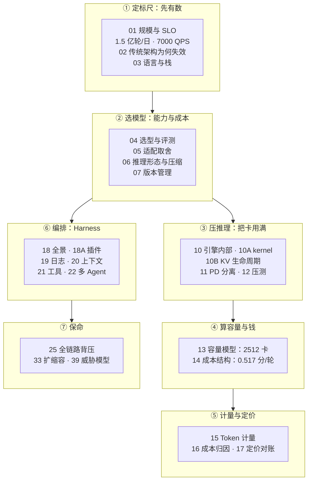

读法是从左上的"标尺"开始，一路到"保命"。**中间有一条隐含的依赖**：P4 的 2,512 卡是用 P3 的并发数算出来的，P3 的并发数又是用 P5 的价目表反推的。所以这几章不能跳着读——数字会接不上。

第 5 章到第 9 章、第 23 章之后的部分（数据、检索、安全、可观测）在图里被压缩成方块了，因为它们不改变主线数字。

## 2. 平台六层：一次请求经过什么

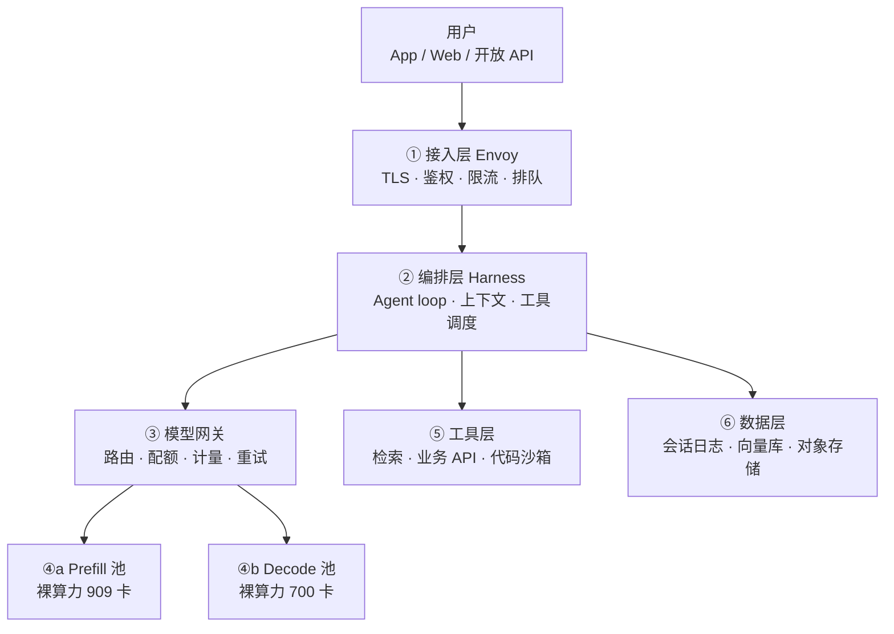

六层里只有第 4 层是 GPU，其余五层都是 CPU 或存储。这个比例很容易被低估：运维成本里 84.5% 是折旧，而折旧里 GPU 占 63.6%——剩下 36.4% 的服务器、网络、机房，撑的是这五层。

图里的 909 + 700 = 1,609 是**裸算力**。加上 1.3 的故障域冗余和 1.2 的灰度与碎片，才是账面上的 2,512 卡。看到任何一处写 2,512，都要记得它包含冗余，不能直接除以 QPS。

## 3. 一次对话的时序：首 token 延迟 258ms 花在哪

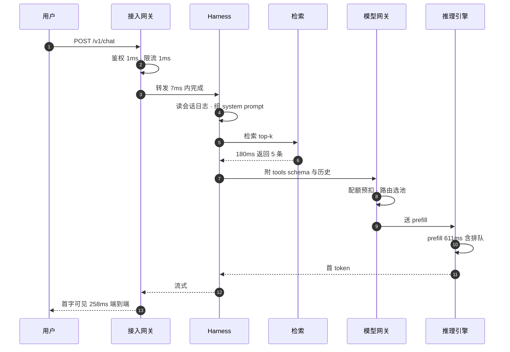

三个数字值得记住：网关只占 7ms，检索占 180ms，prefill（含排队）占 611ms。**优化网关是无效功**，因为它在总耗时里只占 2.7%。

反过来，检索的 180ms 是除了 GPU 之外最大的一块。想压 TTFT（Time To First Token，首 token 延迟），先看检索能不能并行、能不能缓存，再看 prefill 的排队时间。

## 4. 插件树：配置怎么长成一棵运行时

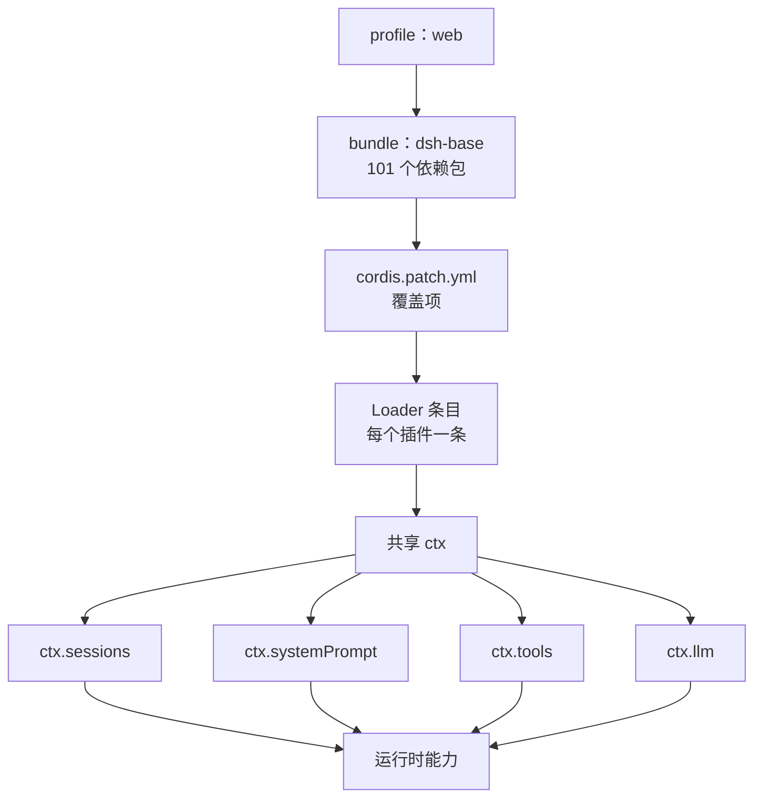

从下往上看更容易理解：**能力来自 ctx 上的几个键，键由插件注册，插件由 Loader 条目加载，条目由 patch 文件决定，patch 由 profile 选中的组合包提供。**

这条链上任何一环断了，表现都一样：某个 `ctx.xxx` 是 undefined。所以排查"功能没生效"要从最下面一层往上查，而不是从代码查。

## 5. 日志与投影：一份事实，四种看法

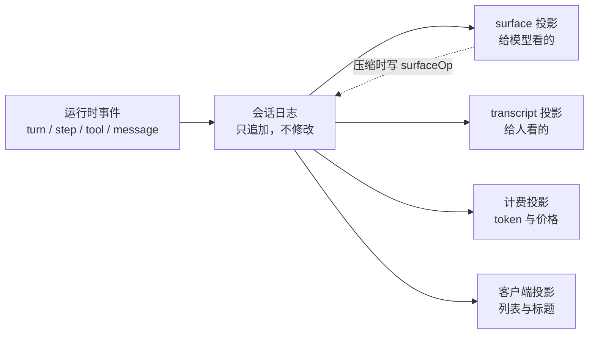

这张图是第 18 章的浓缩。关键在那条虚线：**压缩不是删日志，是往日志里写一条"遮蔽指令"**。

于是同一个会话，模型看到的是被压缩后的版本，人看到的是完整版本，计费看到的是所有 token 之和。三种看法不同，但都来自同一份日志，永远不会互相矛盾。

## 6. 上下文四道工序：什么时候动历史

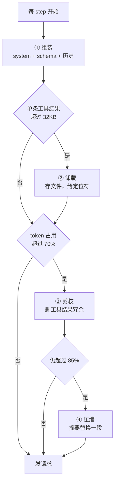

四道工序是**递进**的：先卸载再剪枝再压缩，因为前三者的信息损失依次变大。卸载只损失"全文可搜"，剪枝损失"工具返回的原始结构"，压缩损失"对话细节"。

阈值 70% 和 85% 不是拍脑袋：70% 留出一次完整工具往返的余量，85% 是再压就要影响首 token 延迟的临界点。

## 7. 工具执行：五道流水线

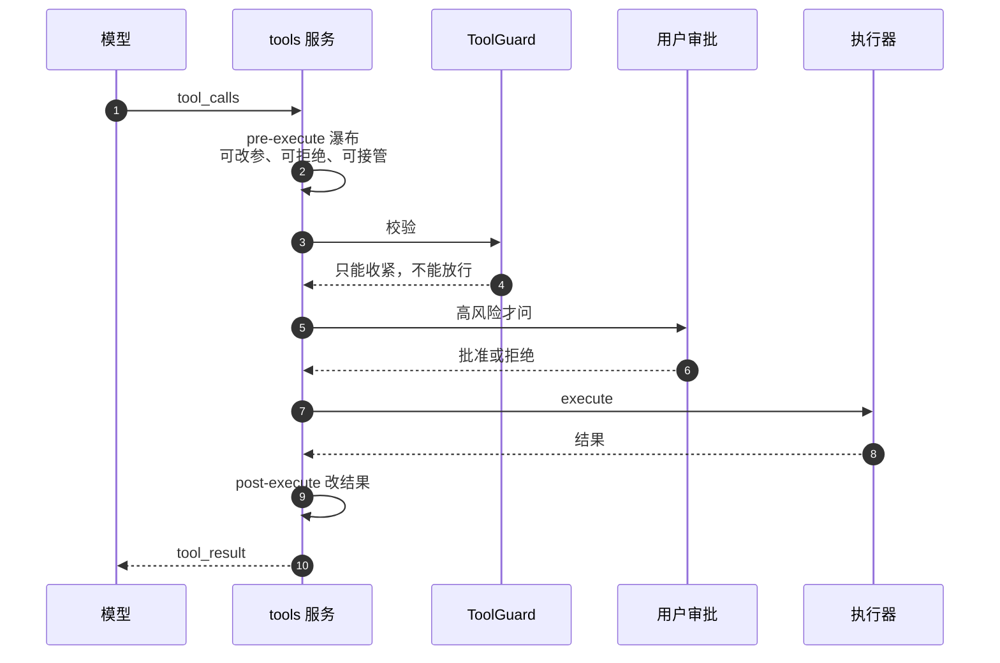

第 3 步是整个设计的关键：`ToolGuard` 的返回类型里**没有 allow**。它只能拒绝，不能批准。前面放宽的，它能收回；它拒绝的，后面任何环节都放不回来。

权限只能沿流水线变小，这是一条结构性保证，不靠自觉。

## 8. 子 agent：派生、并行、汇总

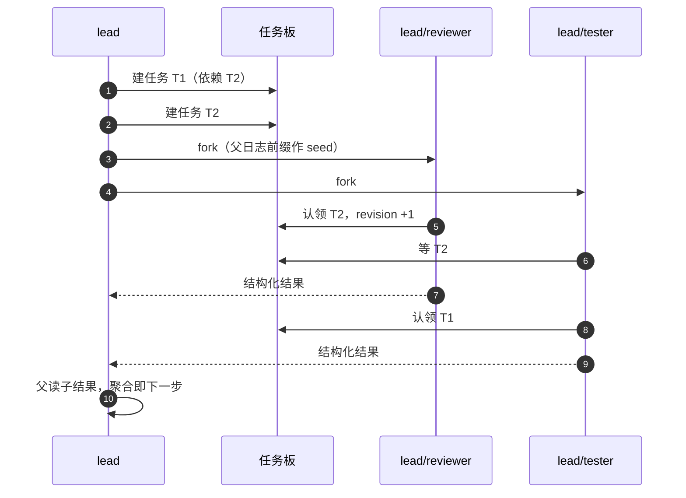

注意两处：任务板的每个字段变更都带 `revision` 自增（比较并交换，防并发覆盖），依赖边 `blockedBy` 必须无环。

还有一处容易被忽略：`writeScopes` 只是路径前缀提示，不是锁。多个子 agent 写同一片目录仍会冲突，靠任务切分避开，不靠运行时互斥。省掉分布式锁的代价是"切分必须切干净"。

## 9. 引擎里一个请求的生命周期

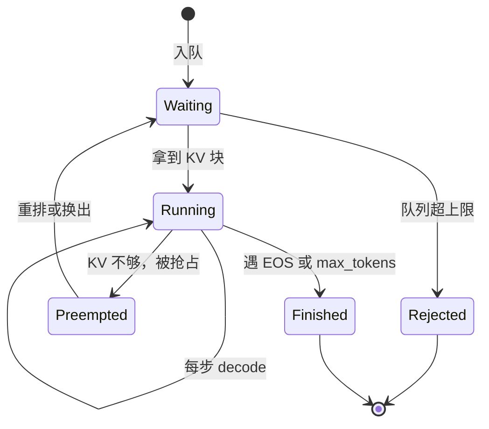

这张图里最重要的一条边是 `Running -> Preempted`。它意味着"已经开始生成的请求也会被踢回队列"——这是显存不足时的最后手段，代价极高：重算要 1.6 秒（32K 上下文），换出要 120 毫秒加一次 PCIe 往返。

理解了这条边，就理解了为什么队列上限要按"目标等待时间 × 吞吐"算，而不是按"机器能排多少"。

## 10. PD 分离：两段式请求路径

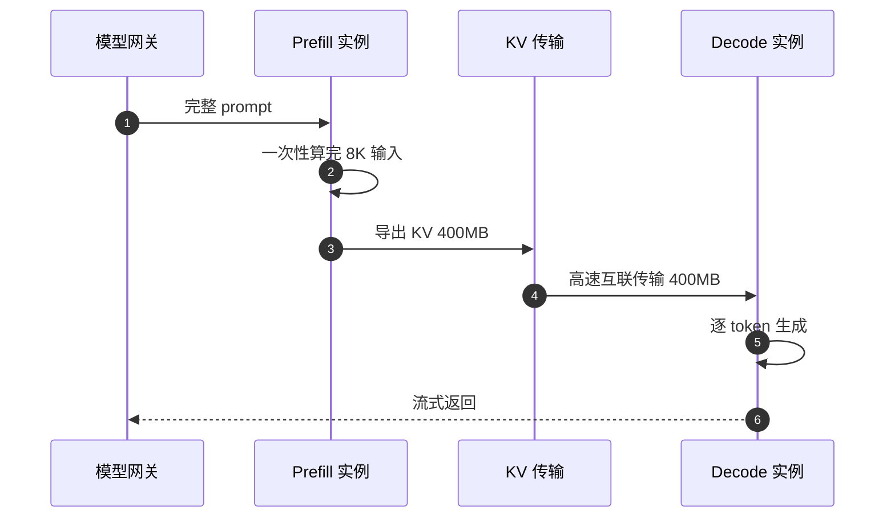

PD 分离的全部代价都在中间那条线上：一次 8K 上下文的 KV 大约 400MB，传输走 RDMA（Remote Direct Memory Access，远程直接内存访问），耗时要和"省下的算力"做比较。

判据很简单：**只有当 prefill 和 decode 的最优并行度差得足够远时，分离才划算**。如果两边都适合 TP8，分离只是多了一次搬运。

## 11. 背压：五道闸按什么顺序关

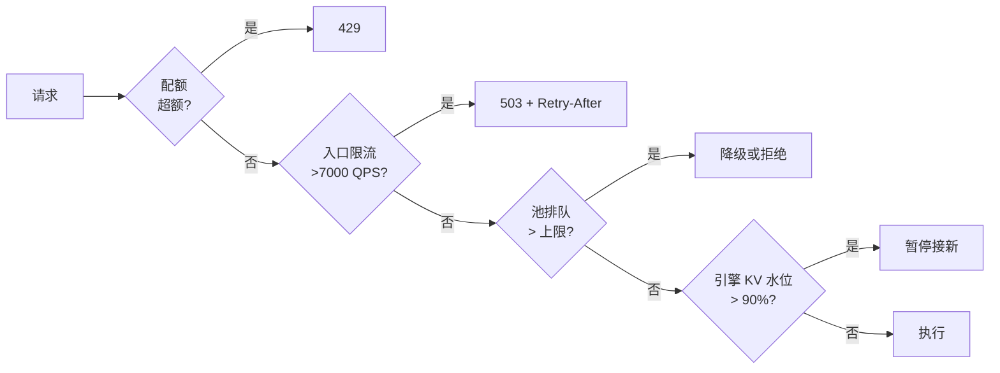

五道闸的顺序由"代价从小到大"决定：配额最便宜（查一个计数器），限流次之，排队再次，KV 水位最贵（要问引擎）。

但**触发顺序是反的**：真实雪崩里最先该动的是引擎侧的降载，因为它是唯一知道"我还撑不撑得住"的一方。上游的闸只能看到"下游慢了"，等它反应，队列已经堆满了。

所以现实中的顺序是"引擎报水位 → 控制面下发 → 上游收紧"，延迟 10 秒左右。这个 10 秒就是雪崩窗口。

## 12. 2,512 卡怎么摊到业务线

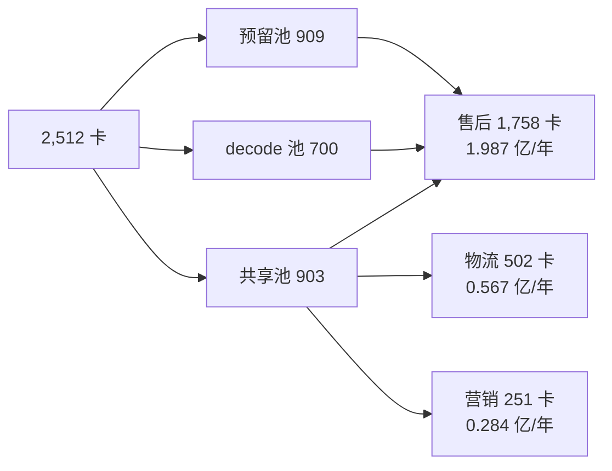

这张图说明为什么"按 token 摊成本"会亏：共享池按实际用量摊，但预留池是按峰值留的。售后占了 70% 的峰值，只用了 72% 的 token——两个数字接近，所以按峰值摊和按用量摊差别不大。

换成营销就反过来了：10% 的峰值、8% 的 token，但它的请求集中在白天。按峰值摊它要多付 575 万，按 token 摊它少付 575 万。**摊法的选择，本质是选择谁来承担峰谷差。**

## 13. 十二张图与章节的对应

| 图 | 想回答的问题 | 对应章节 |
|---|---|---|
| 1 全书地图 | 先读什么后读什么 | 全 |
| 2 六层架构 | 系统由哪几块组成 | 02、08、13 |
| 3 请求时序 | 258ms 花在哪 | 08、25 |
| 4 插件树 | 配置怎么变成能力 | 18、18A |
| 5 日志投影 | 为什么能同时有四种看法 | 18、19 |
| 6 上下文四道 | 什么时候动历史 | 20 |
| 7 工具流水线 | 权限为什么只能变小 | 21、39 |
| 8 子 agent | 并行靠什么协调 | 22 |
| 9 请求状态机 | 什么时候会抢占 | 10、10B |
| 10 PD 分离 | 分离值不值 | 11 |
| 11 背压五闸 | 雪崩时先关哪个 | 25 |
| 12 成本归因 | 谁来承担峰谷差 | 16 |

## 14. 怎么用这套图

三种用法，按你手上的场景挑一种：第一次读、被问架构、线上出故障。

| 场景 | 用法 |
|---|---|
| 第一次读 | 只看图 1、2、3，建立"整体长什么样"，再回去读正文 |
| 面试或评审 | 默画图 2 和图 3，讲清每个数字的来源 |
| 出故障 | 从图 11 倒查：先确认哪道闸动了，再顺着图 2 找对应层 |

第二种最有用。能把图 3 的 258ms 拆解讲清楚，说明你真的理解了这条链路；只会说"网关慢、模型慢"的，是在背结论。

## 15. 失败模式：图会骗人的四种情况

图比文字更容易让人产生"我懂了"的错觉。四种情况要单独防：

| 现象 | 根因 | 怎么发现 | 怎么修 |
|---|---|---|---|
| 图上的数加不回去 | 有的数是裸算力，有的是含冗余 | 把图里的数逐项相加，对上总数 | 每个数标注口径（裸算力/含冗余） |
| 时序图看起来快，实测慢 | 图里没画排队和重试 | 拿真实 trace 对照每一段耗时 | 把排队单独画成一段 |
| 分层图看不出故障传播 | 只画了正常路径 | 沿箭头问"这一层挂了会怎样" | 每层补一条失败边 |
| 架构图画得很全，决策看不出 | 只有组件，没有取舍 | 问"为什么不用另一个方案" | 图上补否决分支 |

第一条最隐蔽。图 2 的 909 + 700 = 1,609，而账面是 2,512——如果图上不写"裸算力"三个字，读者会以为 1,609 就是全部，然后拿 2,512 去除 QPS，算出 0.36 卡/QPS 这种和正文对不上的数。

## 16. 否决与推翻条件

这套图刻意没画的东西，以及什么情况下要把它们加回来：

| 没画的 | 为什么 | 加回来的条件 |
|---|---|---|
| 多区域部署 | 账本是单区域 2,512 卡 | 跨区容灾成为一级需求时 |
| 训练集群 | 只画推理，训练在附录 B | 自研模型进入主线时 |
| 消息队列与缓存 | 属于某一层的内部实现 | 讲解某一层的内部时单独画 |
| 数据血缘 | 和成本归因是两张图 | 做数据治理专题时 |

两条推翻条件，写在这里便于日后对照：

第一，如果峰值 QPS 从 7,000 降到 3,000 以下，图 11 的五道闸要减到三道——低峰时排队本身就能吸收抖动，再加闸只会增加误杀。

第二，如果上下文长度中位数从 8K 涨到 32K，图 9 的 `Running -> Preempted` 这条边会变成主路径，整个调度策略要从"尽量不抢占"改成"按 value 抢占"。

## 17. 复盘卡

```
我原来以为…实际…差在：
```

我原来以为架构图是用来"展示"的，实际是用来"对数字"的——每张图上的每个数字，都应该能在正文里找到推导过程。找不到推导的图，只是装饰。

## 18. 延伸

- 想看推导：从第 13 章容量模型开始，一路算到第 17 章定价
- 想看机制：从第 18 章 Harness 全景开始
- 想看故障：第 25 章背压、第 39 章威胁模型
- 图源：全部用 Mermaid 写在 Markdown 里，改文字即改图

小结：图的价值不在好看，在于它把"我以为我懂了"变成"我能指着某一行说出这个数字从哪来"。十二张图里，能默画出三张，就算过关。
