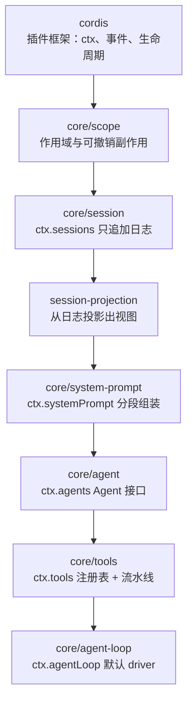
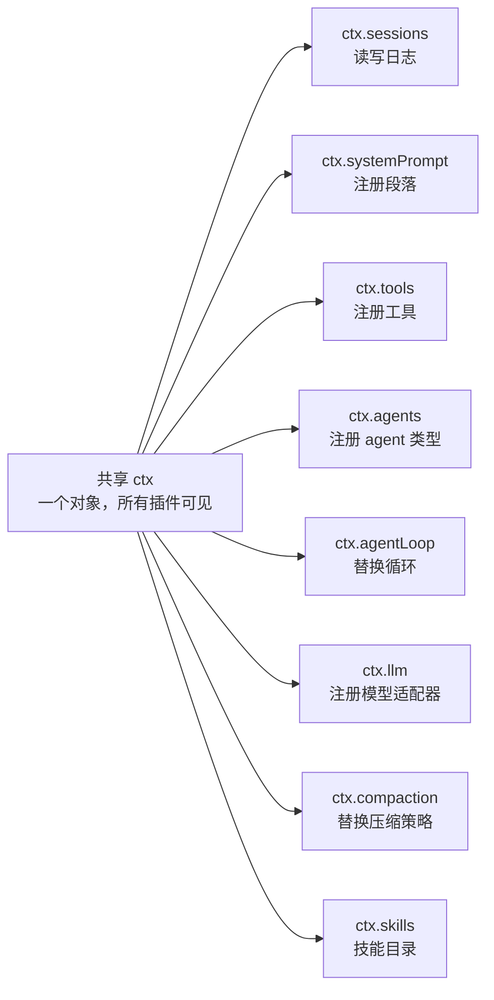
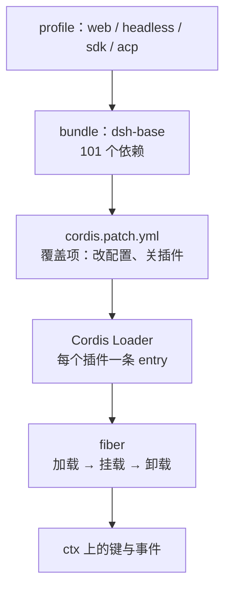
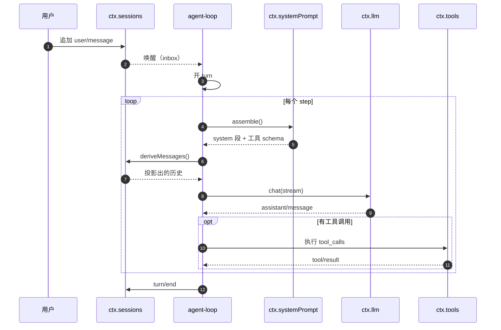
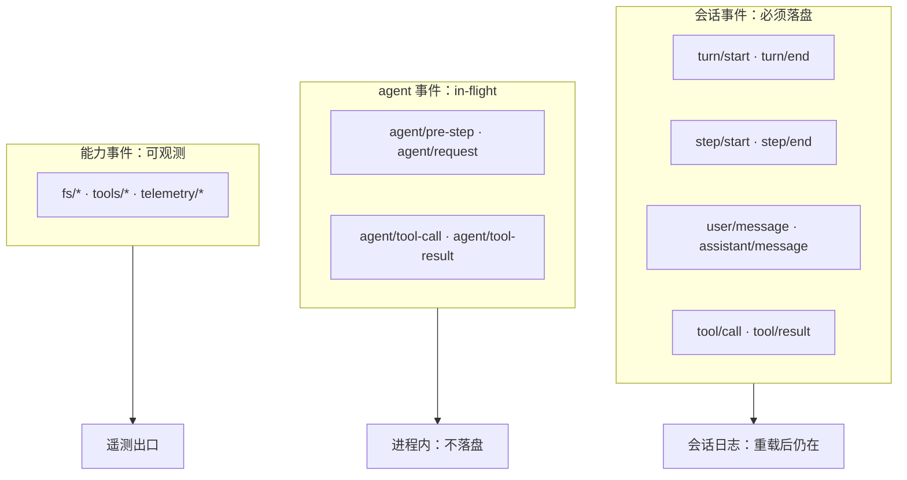
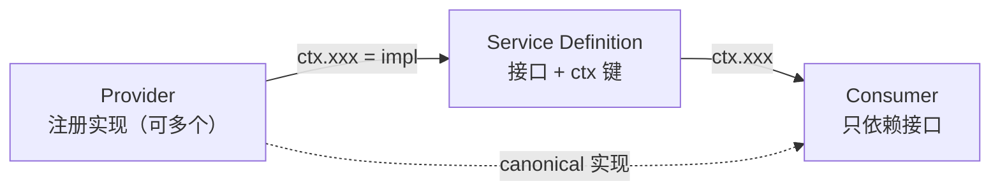
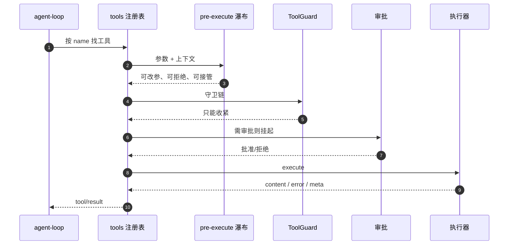
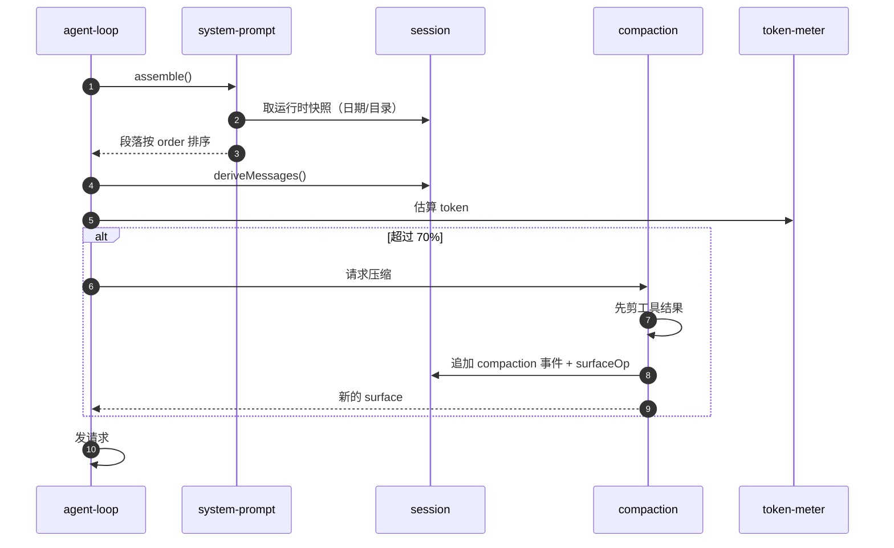
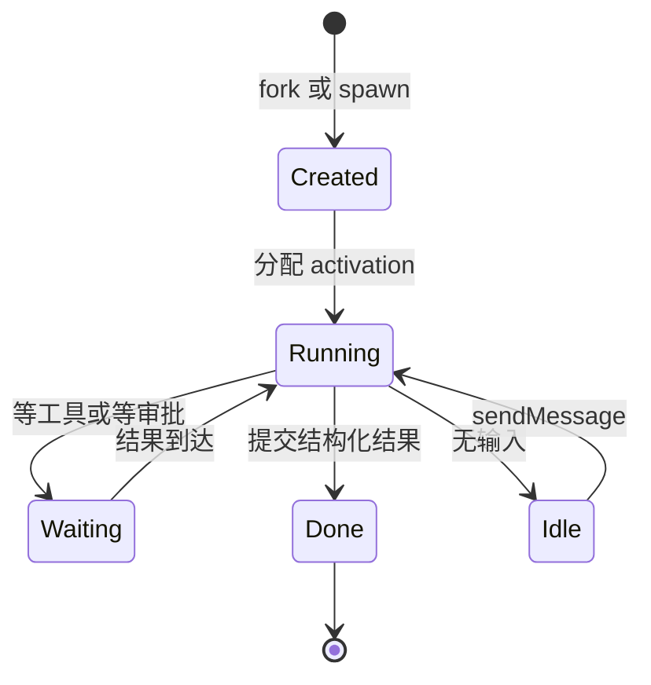
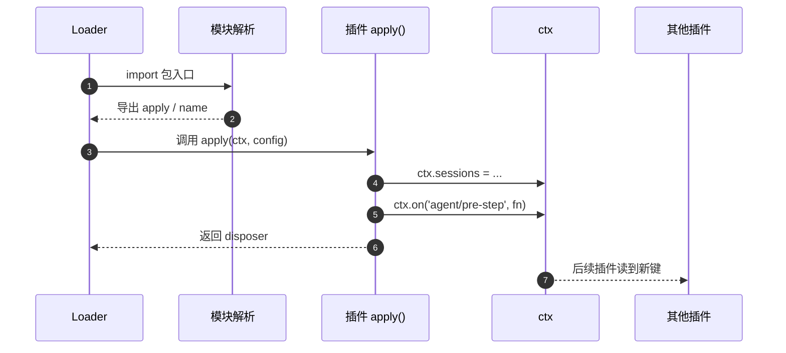

# 第 18B 章 · DSH 的架构图、流程图与时序图

> 第 18 章讲"为什么"，第 18A 章讲"包怎么管"，这一章只做一件事：把 DSH 画出来。
>
> 十张图，从静态结构到动态流程。每张图后面有一段"这张图在说什么"，讲清楚它的约束条件——图能画出来，是因为有些边**不允许存在**。

---

## 0. 图目录

十张图，三种类型，按"先静态、再动态、最后加载"的顺序排。

| 图 | 类型 | 回答什么 | 事实来源 |
|---|---|---|---|
| 1 依赖分层 | 结构图 | 谁能站在谁上面 | 六个核心包的 `peerDependencies` |
| 2 ctx 键 | 结构图 | 插件之间怎么找到彼此 | 八个 `ctx.xxx` 注册点 |
| 3 插件树 | 结构图 | 配置怎么变成运行时 | `cordis.patch.yml` 与 Loader 条目 |
| 4 一次 turn | 时序图 | 一句话怎么走完 | 13 种会话事件 |
| 5 三域事件 | 分类图 | 什么必须落盘 | `session/*` 与 `agent/*` 前缀 |
| 6 seam 三角 | 结构图 | 怎么换掉一个实现 | `ctx.fs` 等能力键 |
| 7 工具执行 | 时序图 | 权限怎么逐级收紧 | `tools/pre-execute` 与 `ToolGuard` |
| 8 上下文 | 时序图 | 压缩什么时候发生 | 70% 与 85% 两个阈值 |
| 9 子 agent | 状态图 | 并行怎么收敛 | 五个状态与三条约束 |
| 10 包加载 | 时序图 | 一个包怎么进入 ctx | Loader 的 apply 顺序 |

每张图后面跟一段"这张图在说什么"。图能画出来，本身就是结论：有些箭头**不允许存在**，那个"不允许"才是设计。

## 1. 先回答一个问题：101 个包，凭什么算"理解清楚了"

不能。101 个包里，大约 90 个是叶子——一个工具、一个存储实现、一个遥测出口。知道它们存在没有意义，改一个也不影响别人。

真正需要理解的是 **6 个核心包 + 3 个机制**：

| 核心包 | 提供什么 | 一句话 |
|---|---|---|
| `core/scope` | 作用域与生命周期 | 一切可撤销副作用的地基 |
| `core/session` | `ctx.sessions` | 唯一真源，只追加 |
| `core/system-prompt` | `ctx.systemPrompt` | 每步重算的提示词 |
| `core/tools` | `ctx.tools` | 注册表 + 把关流水线 |
| `core/agent` | `ctx.agents` | Agent 接口，不含循环 |
| `core/agent-loop` | `ctx.agentLoop` | 默认 driver，可替换 |

三个机制：**共享 ctx**（怎么找到彼此）、**类型化事件**（怎么通知）、**seam 三角**（怎么替换）。其余 95 个包，都是往这 6 个键上挂东西，或者订阅这 3 类事件。

## 2. 图 1：依赖分层——谁能站在谁上面



这张图的约束是**单向**：箭头只向上，任何一层都不允许反过来 import 上一层。这条规则不是靠约定，是靠 `package.json` 的 `peerDependencies` 写死的——`session` 的清单里没有 `dsh-tools`，它想用也没有。

为什么 `tools` 要排在 `agent` 之后？因为工具的上下文里要带 agent 身份（谁在调、权限是什么）。为什么 `agent` 不依赖 `tools`？因为 agent 只负责"决定下一步做什么"，不负责"怎么执行"——执行是 loop 的事。

这条分层的直接后果是：**换掉 loop 不影响工具，换掉工具不影响日志**。101 个包能各自演化，靠的就是这条线。

依赖数量本身也在描述职责：`scope` 只有 1 个 peer，`agent-loop` 有 9 个。越靠上知道的越多，越靠下越纯粹。

## 3. 图 2：ctx 上的键——协调发生在哪里



八个键，就是八个扩展点。所谓"协调一致"，具体是：**没有插件直接调用另一个插件，它们只往 ctx 上挂键、或者从 ctx 上读键。**

举个具体的：一个工具要读会话历史，它不 import `dsh-session`，而是 `ctx.sessions.get(id)`。于是 session 换成 JSONL 实现、换成 SQLite 实现、换成远程实现，工具一行都不用改。

反过来说，如果一个插件的 `package.json` 里出现了另一个**能力包**（不是核心包）的依赖，那基本是设计走错了——它该依赖的是 ctx 上的键，不是那个包。

## 4. 图 3：插件树——配置怎么变成运行时



四个名词对应四层：profile 选组合，组合带 patch，patch 决定条目，条目被 Loader 变成 fiber。

`fiber` 这个词值得单独说：它是插件的**运行实例**，有阶段（pending / active / disposed）。插件不是"加载了就完事"，它随时可以被卸载，卸载时所有副作用按注册顺序逆序撤销。这就是为什么每个注册函数都要返回 disposer——不返回，热重载就会留下幽灵状态。

## 5. 图 4：一次 turn 的时序



这张图里有两处容易被忽略：

第一，**`deriveMessages()` 不是读历史，是算历史**。日志里存的是事件，模型要的是消息数组，中间这层投影每步重算一遍。所以压缩、遮蔽、注入都在这一步生效，日志本身不动。

第二，**step 是循环体，turn 是循环本身**。一个 turn 可以有零个 step（直接回一句话）或多个 step（反复调工具）。终止条件在 loop 里，不在 agent 里。

一次 5 步的工具型请求，落到日志里大约 47 条事件、47KB。拆开看：turn 2 条、step 10 条、消息 12 条、工具 20 条、请求头 3 条。工具事件占了四成，因为每次调用都有 call 与 result 两条。

## 6. 图 5：三域事件——谁必须落盘



三个域的划分标准很硬：**重载之后是否还成立**。

会话事件重载后还在，所以必须落盘；agent 事件是"这一次请求正在发生什么"，进程重启就没了，落盘反而制造垃圾；能力事件是旁路观测，丢几条不影响正确性。

这条区分解决了一个常见困惑：为什么工具调用的**参数**在会话事件里、而**执行细节**在能力事件里。因为参数是"发生过的事实"，执行细节是"这次跑得怎么样"。

代价也很具体：会话事件按 13 种类型、每条约 1KB 估算，1.5 亿轮 × 47 条就是每天 7TB 量级——所以会话日志必须分冷热两层，只有最近 7 天可查全量。

## 7. 图 6：seam 三角——怎么换掉一个实现



seam 的意思是"接缝"：把**定义**、**提供**、**消费**三件事分开。

以文件系统为例：定义是 `ctx.fs` 的接口，提供方有本地实现、沙箱实现、远程实现，消费方是 read/write/edit 这些工具。换成沙箱实现，read 工具一行不改。

代价也在这里：因为消费方只认接口，接口设计错了要改所有实现。所以 seam 的粒度要粗——按能力分（文件、模型、会话），不要按函数分。

## 8. 图 7：工具执行时序（含审批）



权限只有三档：自动执行、需审批、直接拒绝。ToolGuard 能做的只有后两档——它签不出"允许"。

第 3 到第 6 步之间有个容易漏的细节：**审批是挂起，不是阻塞线程**。工具调用挂起时，agent 可以先去做别的，审批结果回来再续。这就是为什么 tool/result 是个独立事件，而不是 execute 的返回值。

## 9. 图 8：上下文组装与压缩



关键在 `surfaceOp` 那一笔：压缩**不删除**日志，而是追加一条"从 seq 118 到 240 用我替换"的指令。于是日志完整、模型看到压缩版、人看到完整版。

这也解释了为什么压缩可以重做：改一个区间就行，原文一直在。

## 10. 图 9：子 agent 生命周期



三个约束：一个子 agent 同时最多一个 activation（不能并行跑两轮）；fork 用的是父日志从 seq 0 开始的**连续前缀**（所以父的历史必须在子创建时就固定）；提交结果即关闭输入（之后只能读，不能再写）。

## 11. 图 10：一个包从磁盘到 ctx



顺序是有意义的：**Loader 按条目顺序依次 apply，后面的插件能看到前面注册的键**。所以插件顺序会影响能力可用性——一个工具插件排在 session 之前，它 apply 时 `ctx.sessions` 还不存在。

这也是为什么 patch 文件里条目的顺序不是随便排的。

## 12. 协调一致的四条规则

把上面十张图压成四句话：

| 规则 | 具体含义 | 违反的后果 |
|---|---|---|
| 依赖只向下 | 核心包分层，反过来 import 不了 | 循环依赖，加载顺序变成玄学 |
| 通过 ctx 通信 | 不直接引用别的插件 | 换实现要改所有调用方 |
| 事件分三域 | 落盘 / in-flight / 观测 | 日志膨胀，或重启后状态不一致 |
| 注册必返回 disposer | 卸载要能撤销 | 热重载留幽灵，行为越跑越怪 |

四条里，第四条最容易被忽视，因为它平时不出错——只在热重载和多次开关时暴露。

## 13. 失败模式

| 现象 | 根因 | 怎么发现 | 怎么修 |
|---|---|---|---|
| 插件 apply 时报 ctx.xxx undefined | 条目顺序在 provider 之前 | 打印加载顺序与键注册时间 | 调 patch 条目顺序 |
| 热重载后行为异常 | 副作用没撤销 | 反复开关三次看状态是否一致 | 注册返回 disposer |
| 两个插件互相等待 | 双向依赖 | 画出 import 图找环 | 抽公共层到 scope |
| 日志里出现重复消息 | 投影被当成真源写回 | 对比 append 次数与消息数 | 只往日志 append |
| 换了实现但行为没变 | consumer 缓存了旧实例 | 重启后对比 | 每次从 ctx 读，不缓存 |

## 14. 验收

1. 能默画图 1 的七层，并说出为什么 tools 在 agent 上面。
2. 能解释为什么压缩不需要"删除"。
3. 能说出三个事件域的划分标准。
4. 能指出你的系统里哪一层正在被反向依赖。

## 15. 复盘卡

```
我原来以为…实际…差在：
```

我原来以为插件化是"注册表 + 回调"，实际差在"依赖方向"——只有把依赖做成单向、把通信收进一个 ctx，101 个包才不会变成一团互相引用的泥。

## 16. 延伸

- 第 18 章：这些机制为什么存在
- 第 18A 章：包与配置怎么管
- 源码：`packages/core/*` 六个包的 `package.json` 就是图 1 的原始依据

小结：看 DSH 只需要看六层依赖、八个 ctx 键、三个事件域。剩下的九十五个包，都是挂在这三样东西上的叶子。
