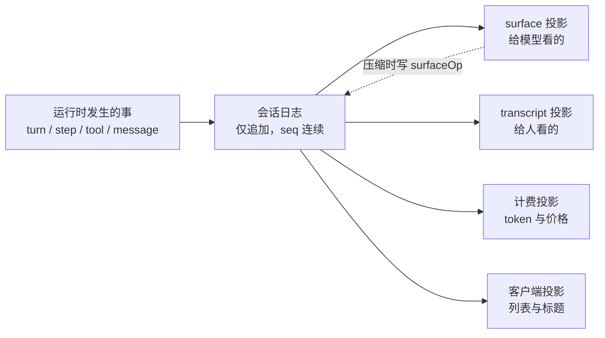
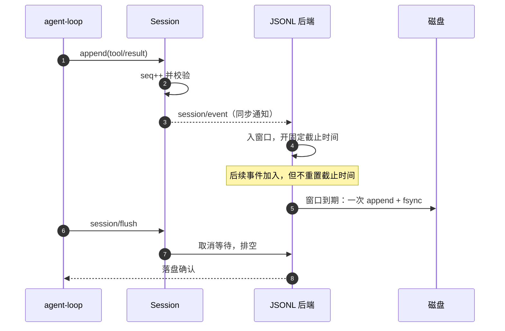
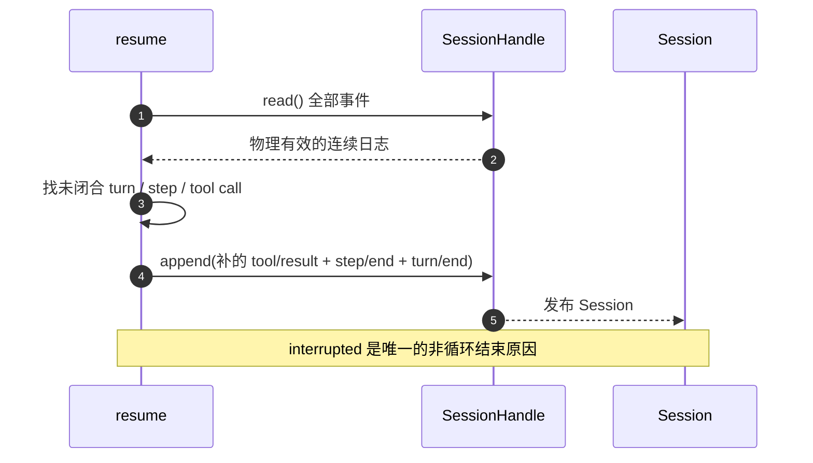

# 第 19 章 · 会话日志与重放：一份事实，四种看法

> 第 18B 章画过一条虚线：压缩时写 `surfaceOp`。这一章把那条虚线展开。
>
> 一个 Agent 系统最难的不是"记住对话"，而是"同一段对话，模型看到的、人看到的、账上记的，为什么可以不一样，却不会互相矛盾"。

---

## 1. 结论：日志是唯一真源，其余全是投影

DSH 的会话层只有一种数据：**仅追加的事件日志**。类型叫 `SessionEvent`，存在 `Session` 里。

模型的对话历史不存在任何地方。它每次要发请求时，从日志**算**出来（`deriveMessages()`）。人看到的对话文本也是算出来的（transcript 投影）。账单上的 token 数同样是算出来的（usage 事件求和）。

四个投影读同一份日志：



这张图值得盯两秒：**虚线是唯一一条从投影回到日志的边**，而且它写的不是"删掉前面"，是"从 seq 118 到 240 用我替换"。

只要这条边只允许写"遮蔽指令"，日志就永远不可能被破坏。这是整个设计的支点。

## 2. 事件的形状

每条事件有一个封套和一份载荷：

```json
{
  "seq": 119,
  "type": "tool/result",
  "time": 1763887441223,
  "data": { "turn": 3, "step": 2, "callId": "call_7", "content": [...] },
  "surfaceOp": "append"
}
```

`seq` 从 0 开始连续，不跳号。一条事件的 JSON 大约 0.5–1KB（带 stream 的 `assistant/message` 能到几 KB）。这条约束比看起来重要：它让"从 118 到 240"这种区间表达成为可能，也让崩溃恢复能判断"尾部是不是被撕掉了"。

核心事件 13 类，按用途分四组：

| 组 | 事件 | 用途 |
|---|---|---|
| 循环骨架 | `turn/start` `turn/end` `step/start` `step/end` | 划出重放的时间轴 |
| 输入 | `user/message` `system/message` `developer/message` | 进入模型的输入 |
| 输出 | `assistant/message` `assistant/attempt` | 模型产出，含 stream 与 usage |
| 工具 | `tool/call` `tool/result` | 调用与结果 |
| 元信息 | `request/header` `session/end-seed` | 请求信封与 fork 边界 |

`assistant/attempt` 是容易被忽略的一条：模型这次调用失败了、被重试了、被取消了，都要留一条记录，但**不能**伪装成一条历史消息。所以它进日志、不进 surface。

## 3. surfaceOp：一条事件怎么进入"模型看到的世界"

产生消息的那几类事件叫 `SurfaceEventType`：`system/message`、`developer/message`、`user/message`、`assistant/message`、`tool/result`。只有它们必须带 `surfaceOp`。

两种取值：

```
'append'                                  // 追加到尾部
{ op: 'replace', startSeq, endSeq }       // 遮蔽闭区间，并在原位置插入自己
```

`replace` 遮蔽的是 **surface 上的位置区间**，不是数字区间。日志里 seq 是连续的，但 surface 上可能已经缺了几段——被更早的 replace 遮蔽掉了。所以区间端点必须指向"当前 surface 里还活着的事件"，而且那些事件必须比新事件更早。

折叠一个会话的 surface，逻辑只有十几行：

```
nodes = []
for e in events:
    if e.surfaceOp == 'append':
        nodes.append(e.seq)
    else:                       // replace
        i = nodes.index(startSeq)
        j = nodes.index(endSeq)
        nodes[i:j+1] = [e.seq]  // 闭区间整体换成一个
```

跑完之后 `nodes` 就是模型看到的消息顺序。每次 replace 提交，`replaceGeneration` 加一；每次 replace 或有插件改了消息内容，`contentGeneration` 加一。增量消费方靠这两个计数器区分"只是尾部长了"和"中间被重写了"——前者可以增量读，后者必须重新投影。

举个具体的。假设日志有 240 条事件，surface 上有 60 条消息。压缩把 seq 20 到 180 之间的 40 条消息概括成一条摘要，写进 seq 241：

```json
{
  "seq": 241,
  "type": "user/message",
  "data": { "role": "user", "content": [{ "type": "text", "text": "前 40 轮的摘要：…" }] },
  "surfaceOp": { "op": "replace", "startSeq": 21, "endSeq": 179 }
}
```

折叠后 surface 变成 21 条消息，日志还是 241 条。原文一条没少，只是被挡住了。

### 3.1 为什么区间用 seq 而不是下标

因为下标会漂。压缩发生一次，后面所有下标都要重算；如果同时有两个并发的 replace，谁先谁后都说不清。

seq 是绝对的。一条事件诞生时号码就固定了，永远不会因为别的事件插入而改变。用 seq 表达"遮蔽哪一段"，这个意图在日志里是**静止的**——一百年后重放，结果一样。

### 3.2 遮蔽不等于删除，且遮蔽可以嵌套

被遮蔽的事件仍在日志里，可以被别的 replace 再次引用。所以会出现"摘要的摘要"：第一层把 20–180 收成一条，第二层把 20–300 收成另一条，中间那一层自己也进了遮蔽范围。

折叠算法天然支持这种嵌套，因为它只维护一个"当前还活着"的节点列表。代价是：想还原某一层的历史，得重新折叠到那一步。

## 4. 压缩写的三个事件

压缩不是一个原子操作，日志里能看到它的三段：

| 事件 | 载荷 | 作用 |
|---|---|---|
| `compaction/start` | `{ turn, step, trigger }` | 开始，带锁语义 |
| `compaction/summary` | `{ range, summary, tokens }` | 摘要内容 |
| `compaction/end` | `{ status }` | 结束或失败 |

`trigger` 有两种：`'pressure'`（超过阈值主动压）和 `'context-overflow'`（已经被上游拒了，被迫压）。

三条都有 `start` 无 `end`，就说明上一次压缩中途挂了。这是可以检测的遗留锁——重启时扫一遍就知道要不要清理，不需要额外的锁表。

压缩前会先调 `ctx.toolResultPruner` 剪一遍工具结果，再让 `ctx.tokenMeter` 重测。**先剪后压**的顺序不能反：剪枝是无损的（原文还能从 spill 里取回），压缩是有损的，能少压一点就少压一点。

## 5. 请求头也在日志里

一个细节：发给模型的请求里，除了消息还有一段"信封"——用了哪个适配器、什么参数、工具 schema 长什么样。它叫 `request/header`，同样进日志。

四种写入原因：

| reason | 什么时候写 |
|---|---|
| `initial` | 会话第一条请求 |
| `resume` | 进程重启后恢复 |
| `change` | 参数或工具集变了 |
| `series` | 没变，但开了一条新的消息序列 |

`foldRequestHeader(events)` 取最新快照就能重建当前信封。于是**每一个请求都可以是日志的纯函数**：给定前缀，重放出来的请求和当时一模一样。

为什么值得把请求头也存下来？因为调试线上问题最常见的一句话是"当时到底发了什么"。如果只存消息不存参数，温度、top_p、工具集任何一个变了都解释不了输出差异——而这些东西恰恰是每次发布都会动的。

`request/header` 不进 surface，它不产生消息。system prompt 也不在信封里，它作为 surface 第 0 号节点上的 `system/message` 存在。所以改提示词是追加一条系统消息，信封保持不变。

## 6. 持久化：一个 seam，两个后端

写盘不是 `Session` 的事。会话层只管内存，落盘走能力 seam：`ctx.sessionPersistence`。

接口四个方法：`create` / `open` / `stat` / `list`，`create` 和 `open` 返回一个 `SessionHandle`（`read` / `append` / `flush` / `close`）。所有日志访问都走句柄，句柄自带**单写者所有权**——同一个会话 id 同时只有一个写句柄，这是靠文件 lease 保证的。

两个后端：

| 后端 | 形态 | 适合 |
|---|---|---|
| `persistence-jsonl` | 每会话一个仅追加文件，默认 Zstd 帧带 checksum，逐批 fsync | 默认，单机、可导出、易排查 |
| `persistence-sqlite` | 逻辑 JSON 事件 + 索引元数据，按帧压缩 | 需要按时间/用户查询，首次打开时导入现有 JSONL |

JSONL 后端的实现细节值得学：**原子实体化**（先写临时文件再 rename）、**逐批 fsync**（不是逐事件）、**第一次新 append 前截断撕裂尾部**。这三件事分别解决"写了一半断电"、"fsync 太慢"、"尾部损坏"。

### 6.1 写窗口：为什么不是来一条写一条

`session/event` 是同步通知，但后端不立刻落盘，而是进一个有界 write-behind 窗口：



关键在"**后续事件不重置截止时间**"。如果每来一条都重置，高频工具输出会让窗口永远不到期——批量写入变成无限推迟。固定截止时间保证最坏延迟有上界。

算一笔账：一个 5 步的请求约 47 条事件、47KB。逐条 fsync 是 47 次磁盘同步，批量是 1–2 次。fsync 在 SSD 上 1ms 上下，在云盘上能到 10ms——47 次就是半秒，足够把 TTFT 的预算吃掉一半。

`session/flush` 是顺序检查点：loop 在领取下一轮输入前调它，拿到"前面都落盘了"的确认。崩溃时能丢的只有窗口里那几条，不会丢一整轮。

## 7. 崩溃恢复：不修复，只补一条

进程在 turn 中间崩了，日志的尾部是这样的：`turn/start` 有，`turn/end` 没有，中间可能还有一个没闭合的 `step/end`，以及几个只发了 `tool/call` 没等到 `tool/result` 的调用。

DSH 的做法是**不截断、不修复**。理由很实在：长任务的一个 turn 能到 20 个 step、上千条事件，那些事件在崩溃前已经持久追加了，删掉等于丢数据。

恢复发生在 resume 时，`agent-loop` 读日志，算出几样东西再补：

- 每个没有结果的 `tool/call` → 补一条错误结果
- 每个没闭合的 `step` → 补 `step/end`
- 一个合成的 `turn/end`，reason 是 `{ kind: 'interrupted' }`

这些作为**普通批次**通过同一个句柄追加。`interrupted` 是唯一一个不是由循环发出的结束原因——它由恢复逻辑发。

只有一种东西会被丢弃：撕裂的物理尾部，也就是那次从未完成的 append 留下的残缺记录。JSONL 后端能部分解码撕裂的 Zstd 帧，把还能读的完整记录重写回去，再截断残渣。



## 8. 重放与 fork

重放不是"再跑一遍模型"，是**从同一组事件重新派生**。

`ctx.sessions.create(id, { seed, meta })` 就是原语：传入一批事件作种子，新会话从 seq 0 开始把它们当自己的历史。派生出消息、surface、请求头，和原会话一模一样。

fork 用的是同一个原语，区别在种子必须是父日志**从 seq 0 开始的一段连续前缀**。这条约束很硬：

- 从 seq 0 开始，保证没有悬空引用
- 连续，保证 `seq` 不跳号
- 前缀，保证不会凭空出现"父亲还没发生的事"

所以子 agent 一旦创建，父的历史就固定在那一刻了。父后面发生的事，子看不见——这不是缺陷，是隔离。

## 9. 格式迁移

日志是有版本的，而且版本只能往前。

- `SessionFormatUnsupportedError`：这个构建读不懂这份日志（版本太新），数据没坏
- `SessionPersistenceCorruptionError`：数据坏了

两个错误分开报，因为处置方式完全不同：前者要升级程序，后者要恢复数据。

迁移规则里有两条容易踩：当前格式恢复**保留**带 `ignorable: true` 的未知事件（向前兼容），历史 v0/v1/v2 迁移则**拒绝**未知类型，哪怕它标了 ignorable（旧格式没有可靠的前向兼容语义）。另外，只要存在比当前构建更高的 generation，就拒绝打开——避免旧程序把新数据写坏。

## 10. 失败模式

| 现象 | 根因 | 怎么发现 | 怎么修 |
|---|---|---|---|
| 压缩后模型说"你之前说过"但内容对不上 | 摘要丢了关键约束 | 对比摘要与原文的关键实体 | 摘要里强制保留约束清单 |
| seq 跳号 | 并发写入没串行化 | 重放时报区间找不到 | 单写者句柄加锁 |
| surface 与 transcript 条数不一致 | 有人拿 transcript 当真源 | 对比 append 次数 | 只从日志派生 |
| 崩溃后同一轮执行两次 | 补 closer 时重放了工具调用 | 查 turn/end 的 reason | 补 closer 只写结果，不重执行 |
| 请求头对不上 | system prompt 被塞进 header | 对比 header 与 surface 节点 0 | 提示词走系统消息 |

最后一条值得展开：把 system prompt 放进 `request/header` 会让信封随着提示词变而变，缓存前缀立刻失效；更糟的是同一个会话里两个请求的 header 不一致，重放时无法确定用哪个。DSH 把它放在 surface 节点上，就是为了让"改提示词"和"改参数"变成两件独立的事。

## 11. 什么情况下这套设计不成立

- **事件量到千亿级且写放大敏感**：每条事件一次 JSON 序列化加校验，1 亿会话 × 500 条就到千亿级，需要换列存或二进制编码。
- **需要强一致的多写者**：单写者所有权是这套设计的前提。多人同时往一个会话里写，得先改成 CRDT 或加中心仲裁。
- **需要按内容检索历史**：仅追加日志不适合做全文检索，得外挂索引，索引与日志的一致性要自己保证。

这三条里，第二条最容易在"多人协作 Agent"场景被撞上。

## 12. 验收

1. 能说清 `replace` 为什么用 seq 而不是下标。
2. 能写出 `foldSurface` 的十行伪代码。
3. 能解释为什么崩溃恢复不截断日志。
4. 能指出把 system prompt 放进 request/header 的两个后果。

## 13. 复盘卡

```
我原来以为…实际…差在：
```

我原来以为"会话历史"就是一份消息数组，压缩就是删掉前面的。实际差在"真源与投影"这层分离——把删除改成遮蔽，日志就变成了不可破坏的事实，而模型、人、账本可以各看各的。

## 14. 延伸

- 第 18 章：日志为什么是唯一真源
- 第 18B 章：十张图里图 4、图 5、图 8
- 源码：`packages/core/session/src/types.ts`、`packages/session/session-persistence-jsonl`

小结：会话层的全部机制可以压成一句——**只追加事件，其余全部现算**。压缩遮蔽区间、崩溃补一条 closer、fork 借一段前缀，三件事都是这句话的推论。
