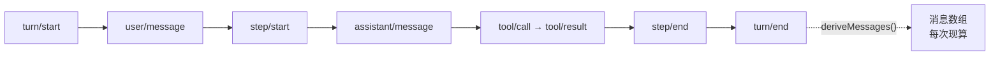
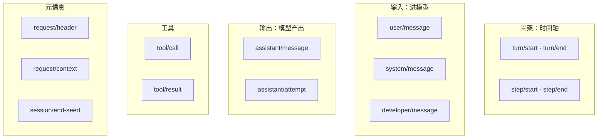

# 第 19 章 · 日志：唯一真源与事件词汇

> 这一章只讲一件事：Agent 的那份会话日志里到底记了什么，为什么这样记。
>
> 不讲压缩、不讲落盘、不讲重放——那是 19B、19C、19D 的事。先把词汇表立住。

---

## 1. 结论：消息数组根本不存在

大多数人设计 Agent 时，第一反应是存一个 `messages: []` 数组：用户说了什么追加一条，模型回了什么追加一条，发给模型时把这个数组原样传过去。

DSH 不这样。它存的是**事件**，消息是算出来的。



差别在哪？存数组的话，一次工具调用要落两样东西：模型的 `tool_calls` 字段，和工具返回的 `tool` 消息。这两个东西格式耦合：OpenAI 叫 `tool_calls`，Anthropic 叫 `tool_use`，Gemini 叫 `functionCall`，三家三套字段名。换一家厂商，历史数据全部作废。

存事件的话，`tool/call` 记的是"模型请求调用 read_file，参数是这段 JSON"，`tool/result` 记的是"返回了这段内容"。至于拼成什么格式发给模型，是投影层的事——换厂商只改投影，日志不动。

这就是"唯一真源"的实际含义：**日志不认识任何厂商的格式**。

## 2. 事件长什么样

每条事件是一个 JSON 对象，一个封套加一份载荷：

```json
{
  "seq": 119,
  "type": "tool/result",
  "time": 1763887441223,
  "data": {
    "turn": 3, "step": 2, "callId": "call_7",
    "content": [{ "type": "text", "text": "..." }]
  },
  "surfaceOp": "append"
}
```

四个字段各有硬约束：

| 字段 | 约束 | 违反会怎样 |
|---|---|---|
| `seq` | 从 0 开始，连续，不跳号 | 区间表达失效，崩溃恢复判断不了尾部 |
| `type` | 必须是已注册的事件类型 | 未知类型分两类处理（见 §3） |
| `time` | 毫秒时间戳，单调 | 排序与耗时统计全错 |
| `data` | 必须是无损 JSON（`isJsonValue` 校验） | 序列化时丢字段，重放不一致 |

`data` 的"必须是无损 JSON"不是一句口号。工具可以在结果里带一个 `meta` 给前端渲染用，但 `Session.append` 会当场校验：传一个 `Map` 或 `Date` 对象进去，直接拒绝，而不是悄悄转成 `{}`。这样做的原因很实在——**落盘时丢字段，重放时就复现不出同一个界面**。

各类事件的体积差两个数量级，估算时按下面这组量级就够：

| 事件 | 典型体积 | 大头在哪 |
|---|---|---|
| `turn/*`、`step/*` | 0.2 KB | 只有序号与时间戳 |
| `user/message` | 1–8 KB | 用户粘贴的正文 |
| `assistant/message` | 2–20 KB | 带 stream 的每个分片 |
| `tool/call` | 0.3–2 KB | 参数 JSON |
| `tool/result` | 0.5 KB–1 MB | 读文件、跑命令的输出 |
| `request/header` | 3–5 KB | 工具 schema 全量 |

一条普通事件约 0.5–1 KB，带 stream 的 `assistant/message` 能到 20 KB，因为它把模型输出的每个分片都存下来了。一台卡跑 2.8 轮/秒，每轮 40–50 条事件，就是每秒 120–140 条写入——这是 19C 要接住的量。

### 2.1 同一条事件，用户能看见什么

封套字段单独解释很抽象，落到页面上就具体了。还是那条 `tool/result`：

| 字段 | 系统里的含义 | 用户能看见的对应物 | 出错时用户看见 |
|---|---|---|---|
| `seq: 119` | 会话第 120 条事件，从 0 连续 | 卡片出现的先后顺序 | 刷新后最后一张卡片消失 |
| `type` | 事件类型，决定投影成什么角色 | 这张是工具结果卡，不是"我发的"或"AI 说的" | 卡片样式错位 |
| `time` | 毫秒时间戳 | 卡片出现的时刻；与配对 `tool/call` 的差就是 loading 时长 | 耗时统计出现负数 |
| `turn: 3` | 第 3 轮用户交互 | 对话列表里第 3 次对话的边界 | 轮次错乱，滚动定位错 |
| `step: 2` | 这一步的第 2 次模型调用 | "正在查订单…→ 正在查退款…"的先后 | 动作顺序颠倒 |
| `callId: call_7` | 与 `tool/call` 配对 | 同一张卡片的标题与结果两半 | 标题是查订单，内容是物流 |
| `content` | 给模型的正文 | AI 下一轮组织回答所依据的那段文字 | 回答里的数字对不上 |
| `surfaceOp` | 追加或遮蔽 | 下一轮还记不记得这件事 | 追问时 AI 说"你没提过" |

一句话：`seq` 管顺序，`time` 管时序，`turn`/`step` 管归属，`callId` 管配对，`content` 管模型，`surfaceOp` 管记忆。

同一条结果其实有三份内容，给三个不同的读者：`content` 给模型，`meta` 给前端渲染卡片，`error` 给系统判定失败（三者的分工见 §6）。用户看到的那张带状态标签的卡片来自 `meta`，模型看到的是 `content` 里那段 JSON 文字。两者不冲突，因为各取所需；但 `meta` 一旦没通过 `isJsonValue` 校验，重放时卡片就画不出来——这是那条硬约束在界面上的后果。

## 3. 十四类事件，五组分工

核心事件 14 类。按职责分五组：



五组的划分标准是**回答什么问题**：骨架回答"什么时候"，输入回答"给了什么"，输出回答"产出了什么"，工具回答"做了什么"，元信息回答"用什么配置做的"。

这 14 类之外，插件还能通过 declaration merging 往同一张表里加仅日志事件。当前版本一共 65 类、36 个命名空间，其中只有 5 类是产生消息的 surface 事件（`system/message`、`developer/message`、`user/message`、`assistant/message`、`tool/result`）——只有这 5 类必须带 `surfaceOp`。

`turn` 和 `step` 是两层循环：turn 是一次用户交互，step 是一次模型调用加它触发的工具执行。一个 turn 可以有零个 step——用户发了一句"你好"，模型直接回，没有工具调用，那这个 turn 里就只有一条 `assistant/message`。

零 step 是合法的，所以要允许。但反过来不成立：没有 `turn/start` 的 `step/start` 是脏数据，加载时会拒绝。

## 4. 三种输入：为什么 user 也要分来源

`user/message` 看起来最直白：用户说的话。但实际有四种来源：

| 来源 | `source` 标记 | 典型场景 |
|---|---|---|
| 真人输入 | 无（默认） | 用户打字 |
| 系统注入 | `agent.inject()` | 文件变更通知、子目录 AGENTS.md、技能内容 |
| 定时任务 | cron | 到点触发的提醒 |
| 目标续轮 | goal | 长目标自动进入下一轮 |

四种来源的消息对模型来说都是 user 角色，投影时原样展开。但日志里必须能区分——因为计费要区分（注入的 token 不该算用户头上），排障也要区分（模型"莫名其妙知道"某个文件变了，是因为有一条注入消息）。

`source` 字段存在的理由在此：**结构上等价，语义上不等价**。

`system/message` 更细，它有三个规则：

- 第一次组装的系统提示词占**节点 0**，哪怕内容是空的也要占位
- 空内容的系统节点保留在 surface 上，但投影时**不产生**模型消息
- 后续系统节点可以被压缩遮蔽，节点 0 只能被系统消息自己替换

节点 0 的特殊性来自缓存：它是最长、最稳定的前缀，一旦被压缩动过，前缀缓存全废。

`developer/message` 是第四种输入，多数实现里见不到。它是"开发者在会话进行中追加的指令"，与 system 分开是因为**生命周期不同**：system 是会话级的，developer 是轮次级或步级的。它带一个 `headerSeq`，指向定义工具增量的那条请求头——因为开发者消息经常伴随着"临时多给一个工具"。

## 5. 两种输出：成功的一条，失败的一条

模型的一次调用有两种结局，对应两类事件：

| 事件 | 什么时候写 | 进 surface 吗 |
|---|---|---|
| `assistant/message` | 产出了内容 | 进 |
| `assistant/attempt` | 失败、重试、取消、流错误 | 不进 |

分成两条而不是合并成一条带 `status` 的事件，理由是：**失败不能伪造历史**。

如果失败也写成一条 assistant 消息，模型的下一轮就会看到"我上次说了这些"——但它其实什么都没说。这会污染后续推理，而且很难排查。

`assistant/attempt` 里存的是那次尝试的原始 stream，给排障用。它的定位是证据，不是对话。

`assistant/message` 里有两个字段值得单独说：

- `stream`：模型输出的紧凑分片记录，带时间戳。它是回放、计费和 UI 的证据，不是第二条消息。
- `usage`：token 计数，跟消息**同体**存储，没有独立的 usage 事件。

为什么 usage 要跟消息绑在一起？因为一次调用产出的 token 和这次调用是同一件事。拆成两条事件，就会出现"有消息没计量"或"有计量没消息"的半截状态。

还有一个 `interrupted: true` 标记：流式输出到一半被取消，已经吐出来的那部分要作为一条 assistant 消息落下来，并标记中断。不标记的话，重放时就分不清"模型只说了半句"和"模型说完了但内容短"。

## 6. 两种工具事件：参数为什么存原始字符串

`tool/call` 存的是模型产出的**原始 JSON 字符串**，没有解析：

```json
{ "callId": "call_7", "name": "read_file", "arguments": "{\"path\":\"/tmp/a.txt\"}" }
```

为什么不在写入时就解析成对象？因为解析失败本身是重要信息。模型可能吐出格式错误的 JSON，或者参数类型不对——如果写入时解析，失败就丢了，你只知道"这条工具没执行"，不知道"模型吐了什么"。

存原始字符串，解析推迟到执行前，失败原因就能完整保留：`Invalid JSON at position 12`。

`tool/result` 有三个可选字段，容易混淆：

| 字段 | 给谁看 | 说明 |
|---|---|---|
| `content` | 模型 | 结果正文，进 surface |
| `error` | 系统 | 失败身份，仅 `isError: true` 时可带 |
| `meta` | 前端 | 渲染载荷，核心不管形状，但必须可序列化 |

`meta` 是"给界面用、不给模型看"的那部分。比如编辑文件的结果，模型只需要知道"改成功了"，前端需要知道"改了哪几行、diff 长什么样"。这份 diff 就放 `meta`，重放时能画出一样的卡片。

## 7. 请求头：让每个请求成为日志的纯函数

`request/header` 存的是发给模型的信封：哪个适配器、什么参数、工具 schema 长什么样。

四种写入原因：

| reason | 何时写 |
|---|---|
| `initial` | 会话第一条请求 |
| `resume` | 进程重启后恢复 |
| `change` | 参数或工具集变了 |
| `series` | 没变，但开了一条新的消息序列 |

`request/context` 是另一条只记日志的元信息事件：路由、容量、系统提示更新模式变化时才写一条。它不参与请求重建，也不参与信封相等性比较——换句话说，它记录的是"这条请求走了哪条路"，而不是"这条请求长什么样"。两者分开的原因很实际：路由变了不该让前缀缓存失效，而信封变了必须失效。

`foldRequestHeader(events)` 取最新快照即可重建当前信封。于是有了一个很强的性质：**给定日志的任意前缀，能精确复原当时发出的那个请求**。

这条性质在排障时价值极高。线上最常见的问题是"同样的输入，为什么今天答得不一样"，答案通常在信封里：温度改了、工具集少了一个、`max_tokens` 被调小了。如果只存消息不存信封，这些差异全部不可见。

信封平均 3–5 KB，其中工具 schema 占八成：20 个工具的 schema 约 2,800 token，比大多数对话正文还长。工具集少给一个不只是权限问题，也是每次请求 3 KB 的传输与缓存问题。

信封有两条格式约束：不能包含 `system` 字段（系统提示词走 surface 节点 0），空工具列表和空默认值要省略而不是写成 `[]` 和 `{}`。这两条是为了让信封在"什么都没变"时保持字节级一致——否则每个请求都会因为序列化差异被判定为 `change`。

## 8. 一次典型请求有多少条事件

一次 5 步、10 次工具调用、含 1 次重试的请求：

| 类别 | 条数 | 说明 |
|---|---|---|
| `turn/*` | 2 | 一进一出 |
| `step/*` | 10 | 5 步各一对 |
| `user/message` | 1 | 用户输入 |
| `system/message` | 2 | 初始 + 一次更新 |
| `assistant/message` | 5 | 每步一条 |
| `assistant/attempt` | 1 | 那一次重试 |
| `tool/call` | 10 | |
| `tool/result` | 10 | |
| `request/header` | 4 | initial + 3 次变化 |
| 其他（hook、压缩） | 2 | |
| **合计** | **47** | 约 47KB |

工具类事件占了 40%（20/47），因为每次调用都有 call 和 result 两条。按 1.5 亿轮/日、每轮 20 条工具事件算，光工具事件就是 30 亿条/日。这也解释了为什么工具结果要剪枝、要卸载——它们是日志里增长最快的部分。

## 9. 本章没讲什么

四件事各有专章，这里只说明边界：

| 问题 | 去哪章 |
|---|---|
| 事件怎么进入"模型看到的历史" | 19A（surfaceOp 与投影） |
| 上下文超了怎么压 | 19B（压缩与卸载） |
| 怎么落盘、崩了怎么办 | 19C（持久化与崩溃恢复） |
| 怎么重放、怎么 fork、格式怎么升级 | 19D |

先立词汇再拆机制，是因为后面四章都在同一个假设上展开：**日志只追加，事件不可变**。

## 10. 失败模式

| 现象 | 根因 | 怎么发现 | 怎么修 |
|---|---|---|---|
| 换模型后历史读不出 | 日志里存了厂商格式 | 看事件里有没有 `tool_calls` 这类字段 | 只存语义事件，格式在投影层 |
| 重放画面与当时不一致 | `meta` 里有不可序列化对象 | `append` 时被拒或落盘后丢字段 | 强制 `isJsonValue` 校验 |
| 计量对不上消息数 | usage 拆成了独立事件 | 比对消息条数与 usage 条数 | 与消息同体存储 |
| 模型"记得"自己没说过的话 | 失败尝试写成了 assistant 消息 | 查 `assistant/attempt` 是否缺失 | 失败只记 attempt |
| 注入内容的 token 算到用户头上 | 没记 `source` | 按来源分组统计 | 投影与计费都读 `source` |

## 11. 什么情况下这套事件模型不成立

- **单轮、无工具的问答**：存事件比存消息重，字段多一倍，收益接近零。
- **需要按消息做全文检索**：事件是结构化的，搜"哪句话出现过"要先把事件投影成文本，多一层。
- **需要强 schema 校验的历史**：事件是开放集合（插件可合并新类型），类型安全靠运行时校验，不靠数据库约束。

第一条最容易被忽略：这套设计是给"有工具、多轮、要重放"的场景准备的，不是通用聊天记录方案。

## 12. 验收

1. 能说出 `assistant/message` 与 `assistant/attempt` 的分工，并解释为什么不能合并。
2. 能解释 `tool/call` 为什么存原始 JSON 字符串。
3. 能说出 `request/header` 的四种 reason，以及它带来的那条性质。
4. 能算出一次 10 次工具调用的请求，工具事件占多少条。

## 13. 复盘卡

```
我原来以为…实际…差在：
```

我原来以为会话日志是"给审计看的备份"。实际差在它是唯一真源——消息数组、界面卡片、账单，全是它算出来的投影。理解了这一点，后面四章才有地基。

## 14. 延伸

- 第 18B 章：图 4（一次 turn 的时序）、图 5（三域事件）
- 第 19A 章：事件怎么变成模型看到的历史
- 源码：`packages/core/session/src/types.ts`

小结：13 类事件、一个连续 seq、一份无损 JSON。日志不认识任何厂商格式，所以它能活过每一次换模型。
