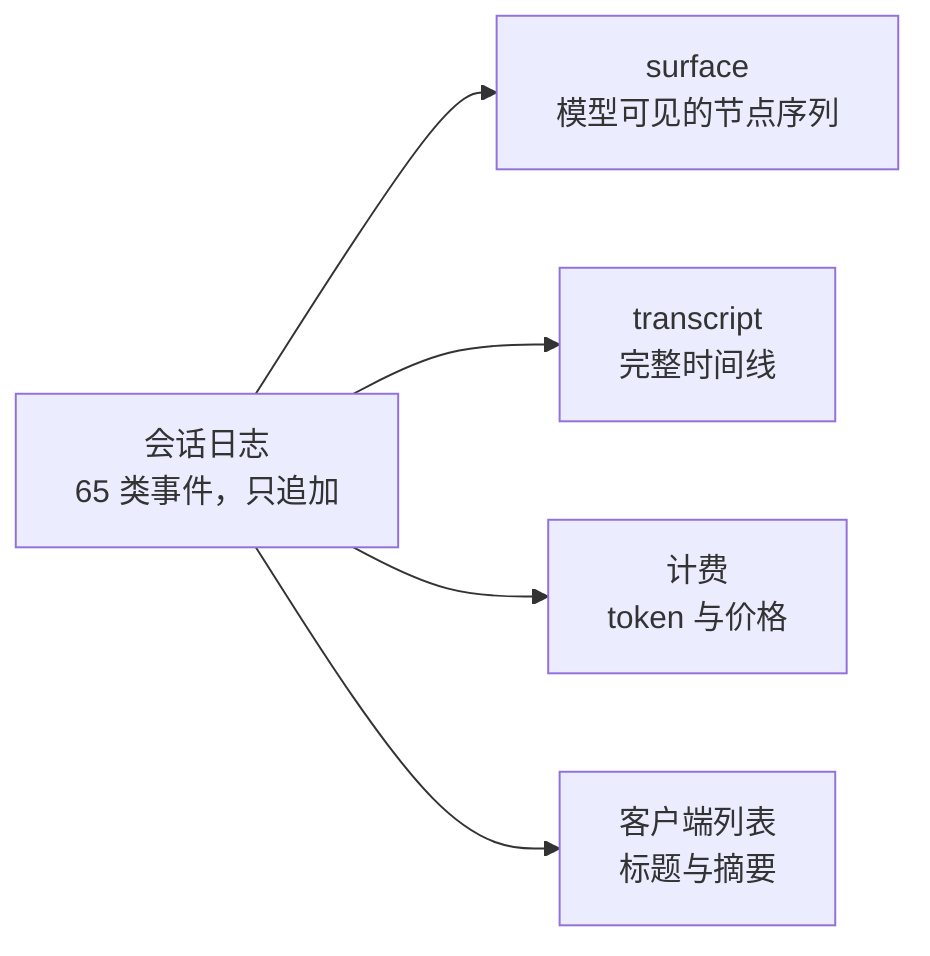

# 第 19A 章 · surface 与投影

> 上一章立了词汇表：65 类事件，其中 5 类会变成消息。
>
> 这一章只回答一件事：**那 5 类事件怎么变成"模型这次看到的历史"**，以及为什么同一份日志能同时供出四种不同的画面。

---

## 1. 结论：模型看到的那层是算出来的

日志只追加，永不修改。但模型每次请求看到的历史得能变短——上下文装不下的时候，只能压。

这两个要求在存储层没法同时满足：允许改，就不是只追加了；不许改，就压不了。

三种做法，代价各不相同：

| 方案 | 压缩怎么做 | 审计能看到什么 | 换厂商 |
|---|---|---|---|
| 存 `messages` 数组 | 真删。删完原文就没了 | 只有压缩后的版本 | 历史全部作废 |
| 每轮存一份完整快照 | 存新快照，旧快照留着 | 能回看，但存储量按轮数平方增长 | 依然作废 |
| 日志 + 可见层 | 追加一条"遮蔽"事件 | 全量都在，一字不少 | 只改投影 |

DSH 用第三种：**日志之上有一层"当前可见"的视图，叫 surface；压缩不删日志，只在 surface 上遮掉一段。**



四个箭头读的是同一份日志，但过滤条件、排序依据、聚合方式都不同。它们不会打架，因为**没有任何一个投影能反向写日志**——日志只被追加改，其余全是只读推导。

这里有个容易误解的点：surface 不是缓存。缓存丢了可以重算，算出来什么样无所谓；surface 丢了也要重算，但**算出来的结果必须逐字节一致**，否则同一份日志在两个进程里会投影出两份不同的历史，重放就废了。它是语义层，不是加速层。

## 2. 五个词

| 词 | 一句话 | 在哪 |
|---|---|---|
| 节点 | surface 上的一个位置，用 seq 标识 | 折叠结果 |
| 锚点 | 节点的 seq，绝对坐标，永不重用 | 日志 |
| 遮蔽 | 让某个区间在当前 surface 上不可见 | `surfaceOp` |
| fold | 把日志折成节点序列的纯函数 | 投影层 |
| 投影 | 从日志算出某种画面的过程 | 共四种 |

这两个词容易混。**投影是总称**：任何"从日志算出一幅画面"的过程都叫投影。**fold 是其中一种**，而且只做第一步——它只决定哪些节点可见、按什么顺序，输出的是一串 seq，还没有变成消息。

把 seq 变成 `messages[]` 的是消息投影（`deriveMessages()`），它才处理角色、`tool_calls` 结构、厂商格式这些事。所以 surface 这条链是两段：

```
日志 ──fold──> 节点序列 [10, 22, 410] ──消息投影──> messages[]
```

分成两段的好处是可分开失效：遮蔽变了只需重折（节点序列重算），消息内容变了才需重投影（文本重渲）。两者的缓存键也不同，`replaceGeneration` 管前者，`contentGeneration` 管后者。

## 3. surfaceOp：两种放法

只有 5 类事件带这个字段：`system/message`、`developer/message`、`user/message`、`assistant/message`、`tool/result`。其余 60 类在 TypeScript 的类型层就拒绝这个字段——写错编译不过，不靠运行时检查。

| 取值 | 语义 | 用在哪 |
|---|---|---|
| `"append"` | 追加到 surface 末尾 | 绝大多数事件 |
| `{op:"replace", startSeq, endSeq}` | 遮蔽 `[startSeq, endSeq]` 全部节点，在原位置插入自己 | 压缩摘要 |

三条约束：

1. 闭区间，两个端点都包含。
2. 端点指向的节点此刻**还活在 surface 上**。指向已被遮掉的节点，fold 直接报错。
3. `startSeq` 在 surface 顺序上位于 `endSeq` 之前。

第 2 条是关键。它意味着 replace 的坐标基于 surface 上当前可见的节点，与日志里的位置无关。压缩器要遮蔽 118 到 240，它得先知道 118 和 240 现在还在面上——这两个 seq 是从上一次 fold 的结果里取的。

### 3.1 为什么要这条约束

因为遮蔽可以嵌套。第一次压缩遮了 `[118,240]`，surface 变成 `[10,22,41,77,300]`。第二次压缩想遮 `[22,300]`，合法；想遮 `[118,300]`，非法——118 已经不在面上了。

没有这条约束，一次针对已消失区间的 replace 会让 fold 的结果取决于"按什么顺序应用"，重放就不再确定。日志系统最怕的就是"同一份输入，两次运行两个结果"。

### 3.2 闭区间

`startSeq` 和 `endSeq` 指向的两个节点本身也被遮掉。写 `[118,240]` 的意思是"从 118 这个节点开始，到 240 这个节点为止，全部换掉"。

工程上常见的 off-by-one 是把它当半开区间，结果每次多留一个节点在面上。表现很具体：压缩之后模型还能看到一段被压过的旧工具输出，于是它把同一件事又做了一遍。

## 4. 折叠：一段伪代码

```ts
function foldSurface(events: SessionEvent[]): SessionSeq[] {
  const nodes: SessionSeq[] = []
  const index = new Map<SessionSeq, number>()   // seq → 在 nodes 里的位置

  for (const e of events) {
    if (!isSurfaceEvent(e)) continue            // 其余 60 类不参与折叠

    if (e.surfaceOp === 'append') {
      index.set(e.seq, nodes.length)
      nodes.push(e.seq)
      continue
    }

    const { startSeq, endSeq } = e.surfaceOp
    const i = index.get(startSeq)
    const j = index.get(endSeq)
    if (i === undefined || j === undefined || i > j) {
      throw new Error(`stale range ${startSeq}..${endSeq} at seq ${e.seq}`)
    }

    for (let k = i; k <= j; k++) index.delete(nodes[k])
    nodes.splice(i, j - i + 1, e.seq)

    // 位置整体前移，索引重建；生产实现用平衡树避免这一步
    index.clear()
    nodes.forEach((s, k) => index.set(s, k))
  }
  return nodes
}
```

复杂度：追加摊还 O(1)，遮蔽 O(被遮节点数)，索引重建 O(当前节点数)。

这里的"索引"指的是 `index` 那个哈希表：seq → 它在 `nodes` 里的下标。它只为一件事服务——把"118 在 surface 第几位"从线性扫描变成 O(1)。`splice` 之后，被遮区间后面的节点全部前移，映射里存的下标集体失效，所以上面这版直接 `clear()` 再全量重建，求的是正确，不是效率。

真实实现换一种数据结构就不需要"位置"这个数：按 surface 顺序建一棵带子树大小的平衡树（或按块存的分块链表），遮蔽区间是两次分裂加一次合并，代价 O(log n) 或 O(块数)，不再与节点总数挂钩。三种做法的差别：

| 结构 | 追加 | 遮蔽一段 | 适合的规模 |
|---|---|---|---|
| 数组 + 哈希表 | O(1) | O(n)，要重排后面所有位置 | 几千节点，压缩不频繁 |
| 分块链表 | O(1) | O(√n)，只重排受影响的块 | 几万节点 |
| 带子树大小的平衡树 | O(log n) | O(log n)，区间当一等公民 | 十万节点以上 |

判断标准不是"哪个更快"，是**压缩频率 × 节点数**。一天压几十次、节点几千个，数组版本完全够用；把它换成平衡树属于提前优化，反而增加出错面。

一次具体演化：

| 步骤 | 日志追加 | surface 节点序列 |
|---|---|---|
| 起点 | 10, 22, 41, 77, 118, 240 | 10, 22, 41, 77, 118, 240 |
| 第一次压缩 | 300，带 `replace{118,240}` | 10, 22, 41, 77, 300 |
| 第二次压缩 | 410，带 `replace{41,300}` | 10, 22, 410 |
| 又来一条消息 | 420，`append` | 10, 22, 410, 420 |

日志里此时有 9 条事件，surface 上剩 4 个节点，模型只看到 4 条消息。被遮掉的 6 条一条没删。

## 5. 为什么用 seq，不用数组下标

三个理由，一个比一个硬。

**下标会漂移。** 遮掉 `[118,240]` 之后，后面的节点下标全部前移。如果 replace 记的是下标 `[4,5]`，第二次压缩时这两个位置指的已经是别的事件了。seq 是绝对坐标，遮多少次都不变。

**跨窗口折叠需要绝对坐标。** 长会话不会一次全加载，通常从某个 `baseSeq` 开始读一段。上一段最后一个节点 seq 是 240，下一段从 300 起，seq 连得上就能接；用下标还得同时维护"当前偏移"，而遮蔽恰恰会破坏偏移。

**一个字段干两件事。** seq 既是日志排序键，又是节点身份。换成下标就要两个字段，且两者可能不一致——不一致的那天就是最难查的 bug。

代价也真实：replace 的端点没法凭空算出来，只能从 fold 结果里查。压缩器因此总要先投影一次、拿到当前节点列表，才能构造区间。这也是压缩为什么发生在 `agent/pre-step`、紧跟在一次投影之后——那时代价最低。

## 6. 四个投影

| 投影 | 读什么 | 过滤 | 给谁 | 压缩之后 |
|---|---|---|---|---|
| surface | 全部事件，应用 `surfaceOp`，再投影成消息 | 只留当前节点 | 模型 | 变短 |
| transcript | 全部事件，忽略 `surfaceOp` | 按时间排 | 人（审查、回放、执行轨迹） | 不变 |
| 计费 | `assistant/message` 与 `assistant/attempt` | 取 usage | 财务 | 不变 |
| 客户端列表 | `session/title` 一类 | 取最新值 | 列表页 | 不变 |

只有 surface 受压缩影响。这是故意的：压缩是给模型腾地方，不该影响审计、账单和侧边栏。

数字上的差距会很大。一个跑了一周的会话，transcript 累计 300 万 token 很正常，而 surface 可能只有 4 万 token——差 75 倍。账单按累计输入算，一次请求一次计费；审计按 300 万算，全量可查；模型按 4 万算，装得下就行。

### 6.1 执行轨迹：transcript 的一个视图

把这张表落到界面上，就是你在 DSH 里看到的那一列工具卡片。

| 界面上的东西 | 来自哪条事件 |
|---|---|
| 命令全文 | `tool/call.arguments`，原始 JSON 字符串，未解析 |
| 卡片标题 | `tool/call` 的元信息 |
| 输出文本 | `tool/result.message.content` |
| 执行时长 | 两条事件的 `time` 差 |
| 成功或失败 | `tool/result.isError` |
| 失败原因（界面可见） | `tool/result.error.reason`，不进模型 |
| 挂在第几轮第几步 | `turn`、`step` |

由此有三条可以当场验证的推论：

1. **你能看到被压缩掉的原文，模型看不到。** 轨迹读 transcript，读追加来源；模型读 surface。
2. **失败的命令，界面上有原因码，模型只看到 `isError` 加一段文本。** 原因码是给归因用的。
3. **超长输出，模型看到的是定位符。** 超过 32 KB 的工具结果被卸载到 `spill://`，轨迹里仍显示全文。

这也解释了"翻轨迹"为什么是有效的排查手段：它是唯一一条完整时间线，不受压缩影响。

## 7. 三个边界

**空内容的 system 节点。** 节点 0 即使没有内容也留在 surface 上，作为前缀锚点。它在面上，但投影时不产生消息——存在和可见是两件事。

**节点 0 只能被系统消息精确替换。** 系统提示变了，旧节点 0 被遮掉、换成新的。但它不能被一次跨越它的压缩区间顺手遮掉，否则前缀锚点丢了，缓存和重建都出问题。

**跨窗口的 replace 会失败。** 折叠时只加载了从 `baseSeq=300` 开始的一段，某条 replace 声明的区间是 `[118,240]`——端点不在这段里。fold 抛 stale range，调用方要么往前多加载一段，要么跳过这条并记日志。生产上这个错通常出现在分页读历史的时候。

## 8. 代价

**增量便宜。** 纯尾部追加时，fold 只处理新增事件，前面的节点序列原样复用。一次请求新增 47 条事件，摊到每条约 0.5 μs，可以忽略。

**替换贵。** 一次 replace 要重建从被遮位置往后的索引，成本与当前节点数成正比。10 万节点时全量重建在几十毫秒量级——这就是压缩不能每步都做、要用 70% 阈值限频的原因之一。

**深冻结是免费的防护。** 投影返回新数组，元素共享且被冻结。调用方想改一下历史再发出去，运行时直接抛错。代价是每次投影复制一层引用数组：10 万个引用约 0.8 MB，相对 400 GB 的 KV 池可以忽略。

## 9. 失败模式

| 现象 | 根因 | 怎么发现 | 怎么修 |
|---|---|---|---|
| 压缩后模型重复干活 | replace 按半开区间处理，旧输出还留在面上 | 比对 surface 节点数与预期，差 1 | 闭区间，两端都遮 |
| 重放结果与线上不一致 | 区间指向已消失节点，fold 依赖应用顺序 | 同一日志两次 fold 结果不同 | 端点必须活在当前面上 |
| 分页读历史时 fold 抛错 | replace 区间跨出加载窗口 | 错误信息里有 stale range | 按 `baseSeq` 多加载一段，或跳过并记日志 |
| 缓存命中率骤降 | 节点 0 被压缩区间顺手遮掉 | 命中率从 85% 掉到 20% | 节点 0 只由系统消息替换 |
| 同一请求两次投影内容不同 | 消息对象没冻结，被插件改过 | 两次投影结果逐字节比对 | 投影结果深冻结 |
| 前端卡片与模型内容对不上 | 前端读了 surface 而非 transcript | 压缩后卡片数量变少 | 界面一律读 transcript |

## 10. 什么情况下这套设计不成立

1. **会话永远不需要压缩。** P95 会话恒定在上下文窗口的 30% 以内时，遮蔽机制是纯开销，直接存数组更省事。判据是 P95 会话的 token 数，不是平均。
2. **需要精确回滚到某个时间点。** 现在只能重放到某个 seq，没法"撤销上一次压缩"。真要做，得引入分层快照，存储成本按轮数增长。
3. **多人同时编辑同一会话。** fold 是单写者模型。多写者要引入冲突解决，成本远超这套机制省下的那点内存。

## 11. 验收

四个问题，都能用现有日志回答：

1. 给定一份日志和任意一个 `baseSeq`，能否折出与线上完全一致的 surface？——能，说明 fold 是纯函数。
2. 一条 replace 的端点被重新遮蔽后再 fold，会不会抛 stale range？——会，说明约束生效。
3. 压缩前后 transcript 的长度是否一字不差？——是，说明遮蔽没有误删。
4. 同一请求投影两次，消息数组是否逐字节相同？——是，说明深冻结与缓存都正确。

## 12. 复盘卡

```
我原来以为…实际…差在：
```

我原来以为压缩删掉的是日志。实际差在它删的是可见层——日志一条没少，只在 surface 上遮了一段，原文还躺在那儿。理解了这一点，19B 的"回取"才有地方可回。

一句话：日志记住全部，surface 只给模型看它装得下的那部分，另外三个投影各自去读同一份真相。

## 13. 延伸

- **19B 压缩与卸载**：四道工序、70% 与 85% 两个阈值怎么定、摘要里丢了什么会致命。
- **19C 持久化与崩溃恢复**：一个 seam 两个后端怎么选、write-behind 窗口多长。
- **19D 重放、fork 与格式迁移**：fork 的种子为什么必须是连续前缀、四次迁移怎么排。
