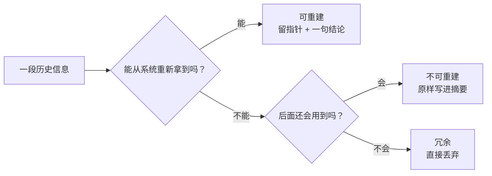
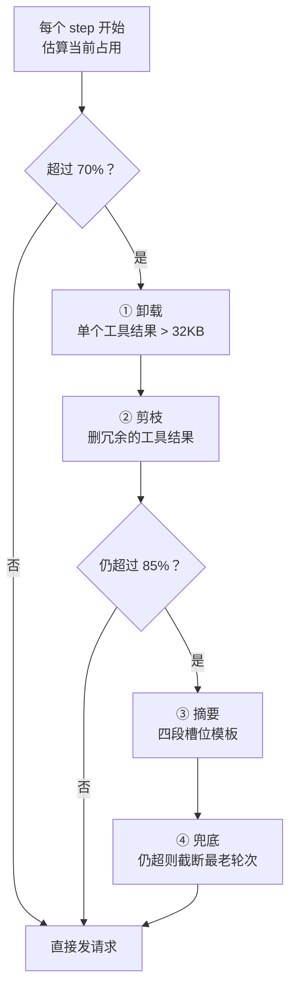

# 第 19B 章 · 压缩与卸载

> 19A 说清了"遮蔽"这个动作：追加一条带 `replace` 的事件，把一段历史从模型眼前拿掉。
>
> 这一章说清"拿掉什么、换成什么"。遮蔽只是手段，真正难的是决定哪段能扔、哪段扔了会出事。

---

## 1. 结论：压缩不是"把对话写短"

多数人第一次做压缩，写的是这个提示词：

> 请把以上对话总结成 500 字以内的摘要，保留关键信息。

跑起来也能用，直到某天用户问"我那个订单 20241108 的退款到哪一步了"，模型答"您还没有提到过订单号"。

问题不在摘要写得不好，在于**摘要把"可重建"和"不可重建"的信息一起压了**。订单号属于后者：它只存在于用户那句话里，扔了就再也找不回来。

所以压缩的第一性问题是分类，不是写作。

| 信息 | 判据 | 处理 |
|---|---|---|
| 不可重建 | 只存在于对话里，系统别处查不到：用户约束、偏好、单号、口头承诺 | 原样保留，进摘要 |
| 可重建 | 系统里还有原件：工具输出、文件内容、网页、日志 | 留定位符 + 一句结论 |
| 冗余 | 重复输出、已解决的报错、被后续结论覆盖的中间过程 | 直接丢 |

一段历史该走哪条路，按这张图判断：



判断"可重建"时有个便宜的检验：**这句话里的每个实体，能不能在系统里被一个查询命中？** 订单号能，用户的语气不能；文件内容能，用户为什么改这个文件不能。

### 1.1 分类的流程与原理

先立一条原则：**分类在写入时做，不在压缩时做。**

写入的那一刻，信息最全——工具名、参数、退出码、耗时、路径、执行时刻都还在手上。到了压缩的时候，这些要么被投影掉了，要么得回头反查。所以正确的分工是：写入时给每条工具结果打一个标注，压缩时只读标注。

流程因此分成两段。

**第一段：写入时打标，五道判据依次过**

1. **有没有地址。** 从参数和结果里抽稳定标识：文件路径、URL、数据库主键、commit sha。抽不到，直接走出口三。
2. **地址稳不稳。** 稳指内容寻址或版本化：git sha、订单 id、带哈希的路径。不稳指会漂移：URL 内容每天变、按关键词搜出来的结果下周就不同。稳的走出口一，不稳的继续往下判。
3. **能不能重放。** 三个条件同时成立才算：只读、幂等、输入可复现。任一不成立，走出口三。
4. **结果是不是"当时的状态"。** 库存、余额、价格、汇率这类，重放拿到的是新数据。是，走出口二（留命令加当时的结论）；不是，走出口一。
5. **重取的代价。** 全表扫描、第三方限流接口、按次计费的调用，即使技术上可重放，也按出口二处理，并要求把"当时结论"写清楚——因为模型大概率不会真去重取。

五道判据落三个出口：

| 出口 | 条件 | 上下文里留下什么 | 怎么还原 |
|---|---|---|---|
| 一、可寻址 | 有稳定地址 | 定位符加一句结论 | 直接读 |
| 二、可重放 | 能重跑，但结果会变 | 命令、时刻、当时结论 | 重跑一次并对照时刻 |
| 三、不可重建 | 无地址，或有副作用 | 原文进摘要 | 不能还原 |

这张表的顺序不能反。先判地址再看副作用，因为一个有副作用的工具也可能产出可寻址的东西（比如退款接口返回的退款单号——单号可查，但那次调用本身不能重放）。判据的对象是**结果**，不是工具。

**第二段：压缩时消费标注**

压缩器只做一件事：读标注，超过阈值就按出口生成对应的替换形态。它不认识任何具体工具。这一点很关键——如果压缩器里写 `switch (toolName)`，每加一个工具就要改一次压缩逻辑，半年后这段代码全是过期分支。

**为什么这五道判据够用**

分类的本质是估一个量：这段信息将来被需要的概率，乘以拿回来的代价。五道判据是这个量的代理变量——地址在不在（能不能拿）、稳不稳（拿回来是不是同一份）、重放有没有副作用（拿了会不会出事）、时效（拿了还有没有意义）、成本（值不值得拿）。

这套东西不追求精确，追求**一致**：同一个工具、同一种结果，任何时候都分到同一类。一致性比准确性重要，因为它决定了重放能不能复现——重放要求同样的输入走同样的路径，分类只要飘一次，两次重放就分叉了。

**标注本身要落盘**

判断结果不能只活在压缩器的内存里。它随事件一起持久化，压缩、重放、审计三个消费方才看到同一份判断。一条标注有五个字段：

| 字段 | 含义 | 谁在用 |
|---|---|---|
| kind | 三个出口之一 | 压缩器决定替换形态 |
| ref | 地址：路径、URL、主键 | 回取时定位 |
| replay | 复现用的命令、参数、目录、时刻 | 重放与排障 |
| gist | 一句话结论 | 摘要直接引用，不必再写一遍 |
| bytes | 原始体积 | 算节省比例、决定要不要卸载 |

`gist` 那一列容易被省掉，但它其实是整套机制里性价比最高的字段：有了它，摘要不必重读原文；没有它，压缩器要么把原文塞回摘要，要么写一句空话。

**最后是校准**

 五道判据是设计时的先验，跑两周就会被数据修正。校准看两个数：每类地址的**回取命中率**（低于 2% 说明没人回头查，可以降级成丢弃）、以及**回取失败率**（高于 20% 说明地址不稳，要升级成不可重建）。分类表是活的，不是评审一次定死的。

## 2. 四道工序，按信息损失从小到大

压缩是按顺序做四次减法，阈值从宽到紧：



顺序不能换，因为四步的损失递增：

| 工序 | 丢了什么 | 还能找回来吗 | 典型收益 |
|---|---|---|---|
| 卸载 | 正文离开上下文，模型只看到定位符 | 能，一条 `read` 命令 | 单条最大 1 MB |
| 剪枝 | 工具结果的原始结构 | 部分，靠回取 | 每次省 20–40% |
| 摘要 | 对话细节与过程 | 不能，只能从原文重读 | 一次能把 10 万 token 压到 2 千 |
| 截断 | 整轮历史 | 不能 | 最后手段 |

先卸载再剪枝，因为卸载只是"搬家"，剪枝是真的"删"。这个顺序看着琐碎，但它决定了最坏情况：如果先摘要把长输出压成一句结论，后面再想卸载就只剩那句结论了。

## 3. 第一道：卸载（spill）

工具输出最容易把上下文撑爆。一次 `grep` 全仓、一次 `read` 大文件、一次网页抓取，都能轻松吐出一兆字节。

处理办法是把正文搬出去，只给模型一个句柄：

```
结果已卸载：spill://session/8f3a/step-12-grep.txt（128 KB，约 31,000 行）
提示：用 read 工具按行读取，或 grep 搜索关键字
```

模型看到三样东西：**位置、大小、怎么拿**。三样缺一，卸载就等于丢失——只给路径不给工具，模型会礼貌地告诉你它看不到文件。

阈值定在 32 KB，理由是边际收益：小于这个体积的结果，模型一次读得完，卸载反而多一次工具往返（约 2 秒 + 2,000 token 开销）。实测分布里，工具结果的中位数在 2 KB 量级，超过 32 KB 的不到 5%，但它们的体积占了总量的六成以上。

卸载还有个副作用值得利用：**卸载之后的引用是稳定的**。同一次会话里 `spill://…/step-12-grep.txt` 永远指向同一份内容，可以反复读、可以 grep、可以被后续步骤引用。这一点比"记住摘要"可靠得多。

## 4. 第二道：剪枝（prune）

剪枝删的是"还剩在原地、但已经没用了"的工具结果。三类最常见：

- **被后续结果覆盖的**：先 `grep` 出 200 个文件，再 `read` 了其中 3 个，那 200 行的清单已经没用了。
- **重复的**：同一文件读了两遍，第二遍只改了三行。
- **已解决的报错**：编译错误改完之后，那一大段报错就是噪声。

剪枝有一条硬约束：**工具调用和结果成对保留**。删了 `tool/result` 却留着 `tool/call`，下一次请求的 `messages` 里就有一个没有响应的工具调用，多数厂商会直接返回 400。所以剪枝的单位是"一对事件"，而非单条。

剪枝之后要重算 token 数，而不是按删掉的字节估算——tokenizer 对 JSON 和代码的切分与自然语言差得远，按字符数估会低估 30% 以上。

## 5. 第三道：摘要（compact）

摘要只在做完前两步还超标时启动。它不追求写一段好总结，只要求**四个槽位全部填满**：

| 槽位 | 写什么 | 预算 | 验收 |
|---|---|---|---|
| 已确认事实 | 用户给的约束、单号、金额、时间、偏好 | ≤300 token | 每个实体能在原文里子串匹配到 |
| 未决问题 | 还没答完的问题、待确认的条件 | ≤200 token | 每条能对应一个后续动作 |
| 已完成动作 | 改过哪些文件、调过哪些接口、结论是什么 | ≤400 token | 动作可复核 |
| 可回取 | 卸载文件的位置、可重新查询的键 | ≤300 token | 至少一条能被工具命中 |

四条要求，每条都有对应的失败：

1. **只写结论，不写过程。** "已确认用户要退 20241108 的订单，金额 299 元"是结论；"用户先问了物流，然后说商品有质量问题，我又问了……"是过程。过程留给 transcript。
2. **实体逐个列出，不做归纳。** "用户提到了几个订单"这种写法等于没写。订单号要写成字面量，能被 `grep` 找到。
3. **动作写清结果，不写意图。** "尝试调用退款接口"没有信息量；"退款接口返回 200，退款单号 R20241108001"才有。
4. **不写"我们讨论了……"。** 这句话占 token，且不可验证。

一个反直觉的观察：**摘要长度和压缩效果不是单调关系**。把 10 万 token 压到 2,000 是对的，压到 300 就开始丢事实——模型随后会反复追问已经确认过的东西，用户感受是"它怎么又忘了"。表现指标是重复提问率，不是摘要长度。

### 5.1 压缩发生在哪，那把锁怎么用

压缩的位置有两个，各管一段：

| 位置 | 时机 | 作用 |
|---|---|---|
| `agent/pre-step` | 每一步开始前 | 主动压缩，压缩完立刻投影，不会把"压到一半"的状态发出去 |
| `agent/request` | 请求组装前 | 兜底，处理上一步工具结果突然把窗口撑满的情况 |

真正麻烦的是并发。同一个会话可能被两个进程同时打开：用户在网页上发消息，同时一条后台任务在跑。如果两边都判断"该压缩了"，就会写出两条互相嵌套的 `replace`，其中一条的端点必然已经失效。

解法是在日志里做互斥，不加外部锁：压缩开始时写一条 `compaction/start`，结束时写 `compaction/end`。后来者读到"有 start 没有 end"，就跳过本次压缩。这把锁有个天然的好处——它随日志一起持久化，进程崩了也不会留下悬空的锁表项。

崩溃留下的遗留锁需要超时释放：超过五分钟没有 `compaction/end`，下一次启动时补一条 `compaction/end` 并标记为 `abandoned`。补这一条而不是删 `start`，因为日志只追加——这也是 19C 那条"补而不修"原则的第一次出场。

### 5.2 压缩的成本记在谁头上

压缩调用是一次完整的模型请求，按 token 计费，记在会话所属租户头上。这一点不做特殊处理，但要在成本归因里单独列一个"压缩"科目——否则运营看到某个租户成本偏高，会去查业务逻辑，而真实原因是它的会话特别长、反复触发压缩。

预算控制放在会话维度：单个会话单日压缩成本超过阈值（比如 5 元），后续压缩退化为只卸载不摘要。这个降级是可接受的：长会话本来就更适合"查得到"而不是"记得住"。

## 6. 回取：压缩的另一半

只要遮蔽不删日志，就能回取。这是 19A 那套设计的直接红利：摘要里写"订单详情见 spill://…/order-20241108.json"，模型需要时能真的去读。

回取的三个前提：

- **有工具**：`read`、`grep`、会话全文检索，至少一个。
- **有线索**：定位符要带语义（文件名、行列号），不能是一串 UUID。
- **代价可接受**：一次回取约 2 秒、2,000 token。如果模型判断"回取比重问用户还贵"，它就不查了。

第三条最容易被忽略。回取率低，往往不是模型懒，是回取的路径太长——比如要求模型先 `list` 再 `read` 再 `grep`，三步才能拿到一个数字，那它宁愿猜。

## 7. 第四道：兜底截断

前三步做完还超，说明这段对话本身装不进窗口。这时只能截断最老的轮次。

截断的判断依据不是"最老"，是"最不相关"：用当前用户消息与各轮的相似度排序，从最低的开始丢。但这一步已经是事故处理，不该出现在常规路径上——正常情况下 70% 阈值应该在会话中期就触发，让上下文永远到不了 85%。

## 8. 两个阈值怎么定

70% 和 85% 不是拍的，各有一个来源。

**70% 是留给"一次完整工具往返"的余量。** 一个 step 里模型可能连续调 3 个工具，每个结果平均 4,000 token，加请求本身的 system prompt 与 schema 约 3,000 token。留 30% 的窗口（8K 上下文里约 2,400 token）刚好够一轮工具往返，不必在半路中断。

**85% 是"再压就要影响首 token 延迟"的临界点。** 摘要本身是一次模型调用：输入是当前全部历史（多数是缓存命中），输出 1,200 token。以 8K 窗口计，一次摘要在卡上约占 300 毫秒，加上排队，用户能感知到卡顿。所以 85% 之前要压完，不能等到 95% 才开始。

阈值也不是越小越好。压得太早，模型反复丢失上下文，重复提问率上升；压得太晚，TTFT 抖动。判断阈值是否合适，看两个数：**重复提问率**（用户重复同一个问题的比例）和**压缩触发的分布**（如果集中在少数长会话，说明阈值合理；如果普遍触发，说明 system prompt 或工具输出本身太大）。

## 9. 压缩自己也要花钱

一次摘要调用的账：

| 项 | 数量 | 单价 | 成本 |
|---|---|---|---|
| 输入（历史，多数命中缓存） | 28,000 token | ¥0.05/百万 | 0.14 分 |
| 输出（四段摘要） | 1,200 token | ¥6.42/百万 | 0.77 分 |
| 合计 | | | 约 0.9 分 |

一次压缩约等于 1.7 个正常轮次的成本。按 5% 的轮次触发压缩估算，一天 750 万次，约 ¥6.8 万/日、2,500 万/年——占 2.83 亿年成本的 0.9%。这个比例可以接受，但如果压缩频率翻倍，就该回头看工具输出是不是太大了。

省这笔钱的办法不是"少压缩"，是**让触发点更晚、单次压得更狠**：一次压到 40% 比压到 68% 更划算，因为后者很快会再触发一次。

## 10. 失败模式

| 现象 | 根因 | 怎么发现 | 怎么修 |
|---|---|---|---|
| 用户重复说过的信息，模型又追问 | 摘要把不可重建的信息当过程压了 | 记忆探针掉分；重复提问率上升 | 四段槽位模板，实体写成字面量 |
| 模型说"我看不到这个文件" | 只给了定位符，没给读取工具 | 回取率为 0 | 卸载时同时给出读取方式 |
| 压缩后回答开始编造 | 摘要写成了自由发挥的叙述 | 抽查摘要有无原文不存在的实体 | 槽位 + 实体子串校验 |
| 压缩后 TTFT 从 258 跳到 1,900 ms | 压缩发生在请求路径上，且缓存全失效 | 按 `compaction/start` 打点 | 挪到 `agent/pre-step`，摘要复用前缀 |
| 摘要的摘要越来越空 | 同一段被压了两次 | 看 `replace` 区间是否嵌套在已遮蔽区间里 | 压缩前检查区间是否还活着 |
| 剪枝后请求 400 | 删了 `tool/result` 留了 `tool/call` | 厂商返回 messages 结构错误 | 剪枝以"调用+结果"为单位 |
| 上下文没超但一直触发压缩 | token 估算按字符数算 | 估算值与实际 usage 差 30% | 用 tokenizer 实测，或按 usage 校准 |

## 11. 什么情况下不需要这套机制

1. **会话天然短。** P95 会话在窗口的 30% 以内，压缩就是纯开销。判据是 token 分布，不是轮次。
2. **上下文窗口足够大且同价。** 1M 上下文与 8K 同价时，压缩从"必须"降级为"省钱手段"，可以只做卸载不做摘要。
3. **业务要求逐字审计。** 摘要天然不可审计。这类场景只能外置 + 检索，把"记住"换成"查得到"。

## 12. 验收

五件事，都能用现有数据回答：

1. 20 道记忆探针（实体召回、约束召回、结论召回、溯源各 5 道），压缩前后各跑一次，掉分不超过 1 道。
2. 重复提问率：压缩上线前后对比，上升不超过 2 个百分点。
3. 回取率：模型在压缩后主动回取的比例，低于 5% 说明线索不够好。
4. 单次压缩成本：约 0.9 分，波动不超过 20%。
5. 压缩触发分布：集中在长会话（P95 以上），而不是普遍触发。

## 13. 复盘卡

```
我原来以为…实际…差在：
```

我原来以为压缩是把对话写短。实际差在它是把"可重建的信息"换成"指针加结论"，长度只是副产品。搞错这一点，摘要就会写成一篇读后感——读着挺好，干活时全是漏洞。

## 14. 延伸

- **19C 持久化与崩溃恢复**：一个 seam 两个后端怎么选、write-behind 窗口多长、崩溃后为什么补而不修。
- **19D 重放、fork 与格式迁移**：种子为什么必须是连续前缀、四次迁移怎么排。
- **第 20 章 提示词组装**：压缩产物怎么和 system prompt 拼在一起，顺序为什么影响缓存。
