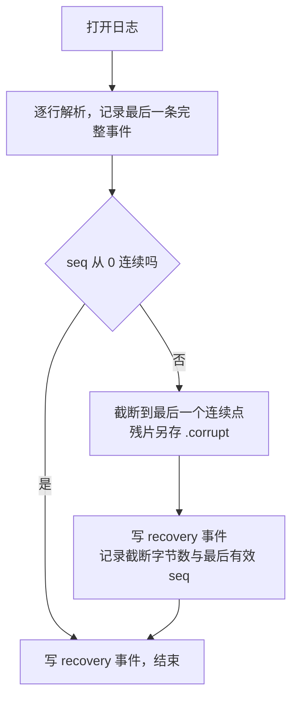

# 第 19C 章 · 持久化与崩溃恢复

> 19A 讲可见层怎么折，19B 讲上下文怎么压。这两件事都建立在一个前提上：日志在磁盘上是完整的。
>
> 这一章讲这个前提怎么保证——写多快、丢多少、崩了之后怎么接上。

---

## 1. 结论：持久化是一个接口，两个后端

日志的写入口只有一个 seam（可替换的能力接口），下面是两个实现：

| 后端 | 形态 | 适合 | 不适合 |
|---|---|---|---|
| JSONL | 一个会话一个文件，一行一条事件，只追加 | 单机、调试、审计、grep 友好 | 高并发写、行级查询 |
| SQLite | 一张表一行，WAL 模式 | 多进程读、按 seq 或 type 查、事务边界清晰 | 跨机、超大单文件 |

选哪个不取决于"哪个更快"。两个后端在单会话写入上都够快——每秒 120 到 140 条、每条 0.5 到 1 KB，合计 60 到 140 KB/s，任何本地介质都吃得下。

真正的判据是**并发模型**：一个会话同时被几个进程打开，读多还是写多，要不要按条件查历史。单写者、读全量的场景，JSONL 更省事；要按 type 过滤、要多个进程同时读、要事务性提交，SQLite 更省心。

接口这一层要窄。只暴露四个操作：`append(events)`、`read(fromSeq, limit)`、`lastSeq()`、`close()`。窄接口的价值是可以在测试里塞一个内存实现，跑重放和崩溃恢复的用例不用碰磁盘。

## 2. 写路径：先问能丢多少

日志写入有三种时序，差别在"什么时候真正落盘"：

| 模式 | 落盘时机 | 崩溃丢什么 | 代价 |
|---|---|---|---|
| write-through | 每条事件写完就 fsync | 最多丢当前这一条 | 每条约 0.1–1 ms，吞吐受限 |
| write-behind | 进程内缓冲，定时或按事件类型 flush | 最多丢一个窗口 | 需要处理"缓冲里有半轮" |
| 异步批 | 攒到 N 条或 T 毫秒再写 | 最多丢一批 | 延迟抖动，恢复要重排 |

一台卡每秒跑 2.8 轮，每轮 40 到 50 条事件，就是一秒 120 多次写入。每条都 fsync 的话，光落盘就占掉 12% 到 100% 的时间——在 SSD 上勉强可行，在共享存储上直接拖垮吞吐。

所以实际用的是 write-behind，窗口按**事件类型**划分，不按时间：

| 事件 | 刷盘时机 | 理由 |
|---|---|---|
| `turn/end`、`session/end-seed` | 立即 | 轮次边界，丢了这一轮等于白跑 |
| `assistant/message`、`tool/result` | 200 ms 内 | 内容大，攒一下摊薄开销 |
| `step/start`、`step/end` | 随下一批 | 纯骨架，丢了能从上下文推断 |

这个划分的实质是：**丢一个 turn 可以接受，丢半个 turn 不行。** 用户重说一遍的成本，远高于每条 fsync 的成本；但恢复出一个做到一半的 turn，模型会基于残缺历史继续执行，那比丢整轮危险得多。

缓冲本身要设上限，而且上限到了要**阻塞写入**，不能丢数据。按每条 1 KB 估，4 MB 的环形缓冲大约装 4,000 条事件，相当于 33 秒的正常写入量。缓冲写满说明下游已经慢到不正常（磁盘打满、网络存储掉线），这时候阻塞会沿调用链往上传导，最终表现为模型请求变慢——这是对的，比静默丢事件好。

## 3. 崩溃恢复：补而不修

进程被杀、机器断电、容器被驱逐，落盘的文件可能长这样：

```
{"seq":118,...}
{"seq":119,...}
{"seq":120,"type":"tool/res
```

最后一行断在半截。也可能出现另一种损坏：每行都完整，但 seq 从 120 直接跳到 123——中间三条没写进去。

恢复算法的四步：



关键在最后一步：**恢复不是把日志改对，是追加一条记录说明发生了什么。**

```
{"seq":121,"type":"session/recovered",
 "data":{"lastValidSeq":119,"truncatedBytes":37,"reason":"partial-line"}}
```

这条事件本身就是历史的一部分。之后任何人读这份日志，都能看到"这里崩过一次、丢了多少、从哪接上的"。如果改成静默截断，日志看上去永远干净，但你就失去了唯一能解释"为什么模型少了一轮记忆"的证据。

这条原则叫**补而不修**：已有字节一个不动，只在尾部截断加追加。它对上层有三个直接好处：

- 重放是确定的——同一份日志，恢复前后折出来的 surface 一致（除了被截掉的那部分）。
- 审计可追溯——损坏本身有记录，不是黑箱。
- 多副本好对齐——两份日志比对时，差异点就是崩溃点，不用猜。

## 4. 恢复之后还要修三样东西

日志接上了，不代表系统能用。三样东西要从日志重新推出来：

| 东西 | 怎么推 | 推不出来的后果 |
|---|---|---|
| surface | 重放 fold（19A） | 模型看到残缺历史，重复干活 |
| token 计数 | 累加 `usage` | 计费少算，对账差异 |
| 会话状态 | 折叠 `turn/start` 到 `turn/end` | 界面显示"进行中"，实际已死 |

第三样最容易被忽略。一个 turn 有 `turn/start` 但没有 `turn/end`，说明它死在中途。恢复时要补一条 `turn/end`，标 `reason:"recovered"`，否则前端会一直转圈，用户以为还在跑。

补 `turn/end` 而不是删 `turn/start`，还是同一条原则：只追加。

## 5. 恢复要多久

时间是能算的：一次恢复要做的事是"从最后一条有效事件往前找到最近的完整边界，再重放折叠"。折叠本身是线性的，10 万条事件在普通机器上约 0.5 到 2 秒。

这个数量级决定了策略：**恢复必须在打开会话时同步完成**，不能放到后台。用户点开一个历史会话，等两秒可以接受；等十秒就会重复点击，而重复点击会并发触发两次恢复——第二次读到的还是旧状态，两次恢复的结果互相覆盖。

事件数再往上，2 秒就守不住了。120 万条事件的会话重放一次要 12 到 24 秒，用户点开就是一片空白。解法是**检查点**：每 2,000 条事件落一个 surface 快照，约 40 KB。恢复时从最近的快照开始，只需重放尾部不超过 2,000 条，耗时降到 40 ms 左右。

代价是快照本身要写、要占空间，按 2,000 条一个算，额外存储开销约 2%。快照还必须带两个版本号：日志的 `lastSeq` 和投影的 `contentGeneration`。只带 `lastSeq` 不够——同一段日志如果因为插件升级改变了投影规则，旧快照就和新规则对不上，这时要用 `contentGeneration` 判定作废。

防并发的办法是单写者加租约：会话打开时拿一个带过期时间的写锁（比如 30 秒自动续期），拿不到就降级成只读。租约要带 epoch（单调递增的编号），每次续期加一；写入时把 epoch 一起带上，服务端拒绝过期 epoch 的写。这套东西和分布式系统里的 fencing token 是同一个思路，只是规模小得多。

## 6. 多实例与共享存储

一个会话在集群里可能被调度到任意一台机器。三种部署形态，代价递增：

| 形态 | 做法 | 问题 |
|---|---|---|
| 单机绑定 | 会话固定在一台机器，后续请求路由回去 | 机器挂了会话就不可用 |
| 共享文件系统 | 所有机器挂同一个卷，靠文件锁 | 锁的语义在 NFS 上不可靠 |
| 日志服务化 | 写入走一个服务，后端是数据库或消息队列 | 多一跳网络，热路径 +1–2 ms |

第三种是规模化之后的必然选择，但它把"日志"从一个文件变成了一项服务，可用性要求跟着上升：日志服务挂了，所有会话都写不进去。缓解办法是本地缓冲加补写——先写本地磁盘，恢复联网后再同步，代价是要处理"本地有、远端有、两边不一样"的冲突。

这里能给的判据是：**单会话 QPS 低、会话数多**的场景，优先选"服务化 + 本地补写"；反过来，会话少、单会话写入密集，单机绑定更省事。

## 7. 保留与归档

日志不能无限留。三层保留，各有各的判据：

| 层 | 时长 | 用途 | 删除前提 |
|---|---|---|---|
| 热 | 30 天 | 会话恢复、回取、排障 | 无 |
| 温 | 180 天 | 审计、复盘、评测取样 | 已归档到对象存储 |
| 冷 | 3 年（合规要求） | 法律与对账 | 合规到期 |

有一个例外：**被 fork 出去的父会话不能按常规期限删。** 子会话的种子是父日志的一段前缀，父日志没了，子会话就打不开。保留期要取"子会话存活期"和"常规期限"的较大值。

归档本身也有格式问题。压缩成 gzip 会丢掉"按行读取"的能力，回取时要先解压整个文件；10 万条事件解压约 1 秒，能接受但不适合热路径。折中办法是按天分片、每片单独压缩，回取时只解压相关那一片。

删除也要有判据，不能只看日期。三条都满足才删：没有活跃子会话引用它、不在任何评测集的取样范围内、最近 90 天没有被回取过。第三条靠回取日志统计，没有这份日志就只能按最保守的期限留。

一个常被低估的量：按 1.5 亿轮/日、每轮 24 KB 估算，日增 3.6 TB，热层 30 天就是 108 TB。这个数字决定了"热层能不能放本地盘"，答案通常是不能，于是又回到服务化。

## 8. 失败模式

| 现象 | 根因 | 怎么发现 | 怎么修 |
|---|---|---|---|
| 恢复后少了一轮对话 | write-behind 缓冲没刷，崩溃在 turn 中间 | 日志里有 `turn/start` 没 `turn/end` | 补 `turn/end` 标 recovered |
| seq 出现重复 | 两个进程同时写同一会话 | 同一 seq 两条事件 | 租约加 epoch，拒绝过期写 |
| 恢复报 JSON 解析错误 | 尾部半行 | 最后一行不以 `}` 结尾 | 截断到上一个完整行，残片另存 |
| 计费少算 | 恢复后没重算 usage | 对账差异集中在崩溃时段 | 恢复流程里加一步累加 |
| 前端一直转圈 | turn 没有结束事件 | 界面上有个会话永远"进行中" | 恢复时补 `turn/end` |
| 子会话打不开 | 父日志被归档删了 | 报 seed 不可用 | 保留期取父子较大值 |
| 恢复耗时 10 秒以上 | 事件数超百万且逐条解析 | 打开会话的 P99 | 加检查点，或按分片并行解析 |
| 快照与日志对不上 | 插件升级改了投影规则，`contentGeneration` 没变 | 恢复出的 surface 与线上不一致 | 快照带 generation，不匹配就丢弃重建 |

## 9. 什么情况下不用这套

1. **会话很短、事件很少。** 单会话不到一万条事件时，内存里维护全量、结束时一次性落盘就够，不需要 write-behind 窗口。
2. **只要事后审计，不需要恢复。** 那写路径可以极简：批量导入、不做 fsync、坏了就丢。
3. **已经有强一致的日志基础设施。** Kafka、Pulsar 这类系统把顺序、持久化、多副本都解决了，自研写路径就是重复劳动，做一层适配即可。

## 10. 验收

五个测试，都能自动化：

1. 强杀进程 100 次，每次恢复后 seq 连续、无重复、无空洞。
2. 人为写入半行 JSON，恢复后截断位置正确，残片文件保留。
3. 10 万条事件的会话，恢复耗时在 2 秒内。
4. 崩溃点前后对比：丢的事件不超过一个 turn。
5. 两个进程同时打开同一会话，只读的那个降级成功，不产生重复 seq。

## 11. 复盘卡

```
我原来以为…实际…差在：
```

我原来以为持久化就是"把事件写进文件"。实际差在**它能丢多少**才是设计参数：write-behind 窗口、fsync 频率、租约时长，全都在回答"崩溃时最多损失什么"。先定损失，再定实现。

一句话：崩溃恢复的目标不是"恢复得像没崩过"，是"崩了之后每一方都能算出自己少知道了什么"。

## 12. 延伸

- **19D 重放、fork 与格式迁移**：种子为什么必须是连续前缀、四次迁移怎么排、旧程序读到新日志怎么办。
- **第 20 章 提示词组装**：日志里的历史怎么和 system prompt 拼成一次请求。
- **第 25 章 全链路背压**：日志服务化之后，它也会成为背压链上的一跳。
