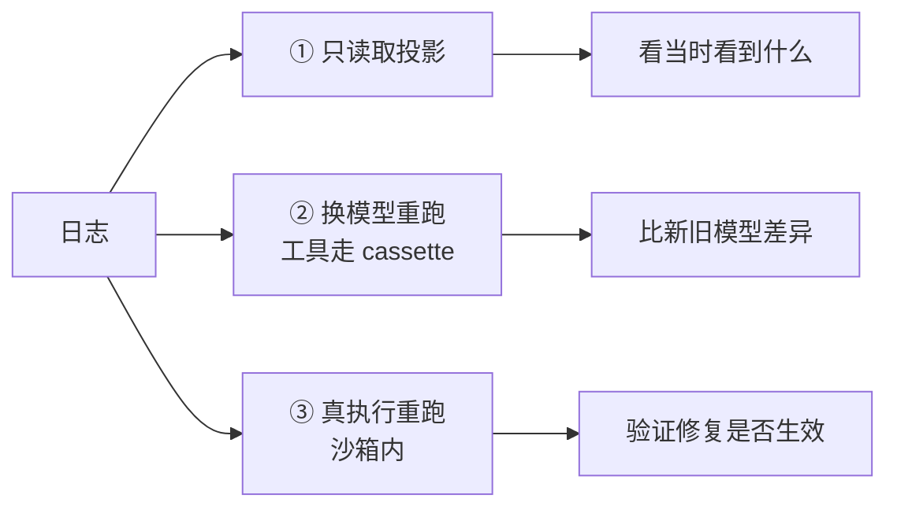
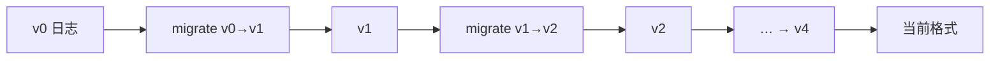

# 第 19D 章 · 重放、fork 与格式迁移

> 19C 解决了"日志不会丢"。这一章解决"日志还能被再用一次"——重放验证、fork 分支、旧日志升级。

---

## 1. 结论：重放是检验日志设计的唯一手段

日志设计得好不好，不看写得多快，看**能不能拿它重放**。重放不出来的日志，只是一堆事后没人看的字节。

这一章要解决三个问题：同一份日志能不能算出同一个结果、能不能从中间分出一条新会话、格式升级后老日志还能不能打开。三个问题各自有硬约束，破一条整套就用不了。

重放有三个用途，成本差一个数量级：

| 用途 | 要什么 | 副作用 | 典型耗时 |
|---|---|---|---|
| 排障回看 | 折出 surface，看模型当时看到什么 | 无 | 毫秒到秒 |
| 回放评测 | 换模型/换提示词，跑同一批轨迹 | 无（工具走录制） | 分钟级 |
| 分支试错 | 从某个点 fork，另走一条路 | 可能有（真调工具） | 分钟到小时 |

三个用途共用同一套基础设施，差别只在"工具调用怎么处理"。

## 2. 重放的三种粒度



| 粒度 | 工具调用 | 能否并行 | 风险 |
|---|---|---|---|
| 只读 | 不执行，直接读 `tool/result` | 完全可并行 | 无 |
| 假执行 | 按 `(工具名, 参数哈希)` 命中录制结果 | 可并行 | 录制过期会骗人 |
| 真执行 | 真的调用 | 受外部系统限制 | 写操作会改真实世界 |

选哪个由目的决定：想回答"换个模型会不会更好"，用假执行；想回答"这个 bug 修了没有"，用真执行；想回答"当时到底发生了什么"，只读就够。

假执行要一份录制。录制的单位是一次工具调用，字段只有五个：工具名、参数哈希、结果内容、`isError`、录制时间。匹配键用"工具名 + 参数哈希"，不用 `callId`——`callId` 每次重跑都会变，参数才是语义上的同一个调用。

```json
{ "name": "read_file", "argsHash": "8f2c…", "result": {"content": "…"},
  "isError": false, "at": 1763887441223 }
```

体积上，一条录制平均 2 KB，一次 10 万轮的真实取样大约 200 万条、4 GB。这决定了 cassette 不适合长期保留，按批次生成、用完即弃更实际。录制过期是假执行最大的坑：工具行为变了，录制还是旧的，重放通过但线上照样报错。

真执行要付的代价不只是风险，还有**不可复现**。同一个退款请求跑第二次，会得到"已退款"而不是"退款成功"，工具结果变了，后面的推理全变。所以真执行重放通常只做一次，且必须在隔离环境里。

## 3. 重放对不上的四个来源

第一次做重放的人常以为"同一份日志重放，结果应该一模一样"。实际能对上的只有一部分：

| 来源 | 是否可复现 | 处理 |
|---|---|---|
| 日志里记录的内容（消息、工具结果原文） | 完全可复现 | 直接读 |
| 模型输出 | 不可复现（采样、版本、硬件） | 重放时记录新输出，与旧的并列 |
| 工具的实际效果 | 不可复现（外部状态变了） | 只比对"调用序列与参数"，不比对结果 |
| 时间戳、ID、随机数 | 不可复现 | 重放时注入固定时钟与 ID 生成器 |

判据是：**重放验证的是"被记录的部分"，不是"重现未来"**。日志记了什么，就能保证什么；日志没记的，重放时只能猜。

这也解释了为什么 `request/header` 要存全量（19 章）——它是"这次请求的信封"，重放时要拿它比对，才知道是不是同一份输入。

## 4. fork：种子必须是连续前缀

fork 是从已有会话分叉出一条新会话。它有个硬约束：**种子只能取从 seq 0 开始的一段连续前缀**。

原因有三层，任何一层破了都 fork 不了：

1. **配对**。`tool/result` 必须能找到对应的 `tool/call`。如果种子从中间截断，第一条可能是孤立的 `tool/result`，投影出来的 messages 里会出现没有 `tool_calls` 的 tool 角色消息，多数厂商直接返回 400。
2. **边界**。截断点必须落在 turn 边界上。落在 turn 中间，新会话一开始就带着一个没有 `turn/end` 的 turn，恢复逻辑会把它判成"崩溃中"。
3. **依赖**。`surfaceOp` 的 `replace` 端点指向的是**当时还活着的节点**。如果种子从某条 `replace` 之后开始，端点就可能落在种子外面，fold 直接报错。

所以 fork 的实现是三步：找到目标 turn 的结束点 k、校验 `[0, k]` 内所有 `replace` 端点都闭包在区间内、把这段前缀复制成子会话的初始日志，再追加一条 `session/end-seed` 记录父会话 id 与 `parentSeq=k`。

复制本身的成本不高：5 万条事件约 50 MB，本地复制耗时 0.3 秒，跨可用区走对象存储约 2 秒。真正贵的是 token——子会话从第 5 万条开始继续跑，第一次请求要带上整段种子，5 万条约 6 万 token，单次 prefill 约 0.5 秒、成本 0.6 分。

种子是**快照不是引用**。父日志之后怎么变、甚至被删，子会话都能独立打开。这是刻意的：如果做成引用，父会话的归档期就成了子会话的寿命上限，而子会话可能活得更久（19C §7 的保留例外说的就是这件事）。

fork 的三个用法：

| 用法 | 怎么用 | 代价 |
|---|---|---|
| 试两条路 | 同一个点 fork 两次，走不同提示词 | 两份 token |
| 评测对照 | 线上轨迹 fork 出来，换模型重跑 | 一批 GPU 时间 |
| 回滚到分歧点 | 用户说"回到刚才那步"，fork 出干净分支 | 一次复制 |

第三种最容易做错：它看起来像"撤销"，实际是"另开一条"。原会话不删，新会话从分歧点长出来，用户看到的是两条历史。界面要显式说明这一点，否则用户会以为旧的那条被改掉了。

## 5. 格式迁移：四次迁移怎么排

事件 schema 会变。DSH 的会话域有 4 个迁移包（v0→v1、v1→v2、v2→v3、v3→v4），加一个 format 包和一个 catalog 包。这个数量说明一件事：**迁移是常态，不是意外**。

迁移的对象是 `data` 里的字段结构，不是日志文件本身。文件格式（一行一个 JSON）从头到尾没变过，变的只是某些事件类型多一个字段、少一个字段、改个名字。

排布方式是一条单向链：



三条规则让这条链条可用：

- **每步只认相邻版本**。v0→v2 写成 v0→v1→v2，不做跳跃。跳跃迁移在版本多了以后是指数级的组合。
- **每步幂等**。同一份 v1 日志跑两次 v1→v2，结果一致。迁移途中崩了可以重跑，不用专门做断点。
- **每步可回滚**。迁移前把原文件留一份（或写到一个新文件），失败就回退。100 万条事件的迁移大约几分钟，回滚成本是磁盘空间。

迁移读的是 `__format` 头或 catalog 里记的版本号。每条事件都带版本太浪费（一天 30 亿条），文件头带一次就够；跨文件拼接时靠 catalog 对齐。

什么时候迁也有两种选择：

| 时机 | 做法 | 适合 | 代价 |
|---|---|---|---|
| 读时懒迁 | 打开旧日志时按需转换，不写回 | 旧会话很少被打开（不足 5%） | 每次打开都付转换成本 |
| 批量迁移 | 定时任务扫全量，一次性升级 | 旧日志占比高、要统一查询 | 一次扫全表，100 万条约几分钟 |

判据是**打开频率**：旧日志一周被打开不到 10 次，懒迁更省；每天有上千个旧会话被回取，批量迁移一次付清更划算。两种可以并存——先批量迁近 90 天的，更早的保持懒迁。

## 6. 旧程序读到新日志怎么办

两个方向，处理方式不同：

| 场景 | 现象 | 策略 |
|---|---|---|
| 旧程序读新日志 | 遇到未知 `type` 或未知字段 | 未知类型分两类：**可跳过的**（`telemetry/*`、`feedback/*`）跳过并计数；**不可跳过的**（surface 事件、`turn/*`）拒绝加载 |
| 新程序读旧日志 | 字段缺失或语义变化 | 懒迁移：读的时候按当前版本解释，缺字段填默认，不认识的旧字段丢弃 |

"不可跳过"的判断标准很简单：**跳过它会不会改变模型看到的历史**。会，就必须拒绝——宁可打不开，也不能打开一个少了几轮记忆的会话让模型接着说。

未知字段的处理要宽松（向前兼容），未知类型的处理要严格（向后兼容的安全边界）。这两条经常被写反：字段宽松是对的，类型宽松会让新版本引入的语义悄悄丢失。

## 7. 怎么判断重放是对的

重放不是"跑完不出错"，要逐点比对。五个比对点，从强到弱：

| 比对点 | 比什么 | 不一致说明 |
|---|---|---|
| surface 节点序列 | seq 列表完全相等 | 折叠逻辑变了，或日志被改过 |
| 请求信封哈希 | `request/header` 的规范化哈希 | 组装逻辑变了，缓存会全失效 |
| 工具调用序列 | `(name, 参数哈希)` 的有序列表 | 模型行为或提示词变了 |
| usage 累计 | input/cached/output 三项 | 计量口径变了 |
| 最终消息 | 文本相似度 | 采样差异，通常不算错 |

差异要分级：结构不一致是致命（必须修），文本差异是警告（记录下来），时间戳差异直接忽略。

一个实用做法是**把重放当回归测试**：每次改折叠、改组装、改提示词，都拿 20 条固定轨迹跑一遍，五个点全过才算没破坏兼容性。20 条的时间成本约 1 分钟，比线上发现"历史打不开"便宜得多。

## 8. 失败模式

| 现象 | 根因 | 怎么发现 | 怎么修 |
|---|---|---|---|
| fork 后第一条消息是 tool 角色 | 截断点不在 turn 边界 | 投影出的 messages 首条 type 异常 | 校验截断点必须是 `turn/end` |
| fork 报 stale range | 种子内 `replace` 端点落在区间外 | fold 抛错 | fork 前做闭包校验，不合法就往前退一个 turn |
| 重放结果每次不同 | 用了真实时钟与随机 ID | 两次重放哈希不一致 | 注入固定时钟与 ID 生成器 |
| 假执行重放骗人 | cassette 过期，工具行为已变 | 重放通过但线上仍报错 | 给 cassette 加有效期，过期就转真执行 |
| 迁移跑一半失败 | 中途崩溃且没留原文件 | 日志版本混杂 | 每步迁移写新文件，原文件保留 |
| 旧程序打开新日志后少了几轮 | 未知类型被静默跳过 | 会话变短 | 按"是否改变模型所见"分类，surface 类直接拒绝 |
| 迁移后体积翻倍 | 每步都追加而不替换 | 文件大小线性增长 | 迁移是重写，不是追加 |

## 9. 什么情况下不用这套

1. **日志只做审计，不做重放。** 那不需要 fork 与迁移链，归档成压缩包即可。
2. **会话生命周期短于 schema 变更周期。** 日志 7 天就删，迁移成本高于重写，让旧日志自然过期更划算。
3. **只有单版本、不跨厂商。** 没有格式差异，`request/header` 的规范化也可以省掉。

## 10. 验收

五个测试：

1. 从任意 turn 边界 fork，子会话能独立打开，模型看到的 messages 首条是 user 或 system。
2. fork 一个内部含 `replace` 的会话，端点校验通过或按规则回退一个 turn。
3. 同一份日志重放两次，surface 节点序列与信封哈希完全一致。
4. 一份 v0 日志迁移到 v4，五个比对点全部通过，原文件仍可读。
5. 人为注入一个未知类型事件，旧程序拒绝加载而不是静默跳过。

## 11. 复盘卡

```
我原来以为…实际…差在：
```

我原来以为 fork 就是"复制一段历史"。实际差在**连续前缀**这个约束：三条依赖（配对、边界、闭包）任何一条破了，复制出来的会话就打不开或者语义错乱。所以 fork 不是复制，是一次带校验的快照。

一句话：日志的价值 = 写入时的完整性 × 事后还能被重放几次。

## 12. 延伸

- **19A surface 与投影**：`replace` 的闭区间语义与 fold 的报错条件。
- **19C 持久化与崩溃恢复**：为什么父会话保留期要覆盖子会话。
- **第 20 章 提示词组装**：信封哈希由什么决定，为什么改顺序会让缓存全失效。
