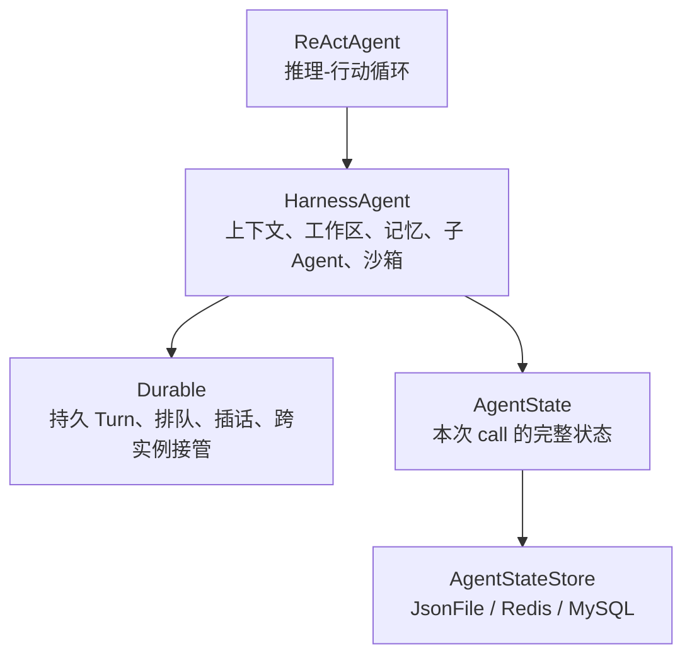

# S1 · 两个实现：真源放在相反的位置

> 这一组章节（S1–S8）读第二个实现：[**AgentScope Java**](https://github.com/agentscope-ai/agentscope-java)（Apache-2.0，JDK 17+，6,470 stars）。
>
> 它和 DeepSeek Harness 解决同一组问题——长任务、工具、上下文、多副本——但把"什么是真的"放在了相反的位置。这个差别决定了后面所有工程的形状。

---

## 1. 结论：读第二个实现的价值在"相反答案"

只读一个实现，你会把它的选择当成唯一解。读第二个，你会看到同一组约束下还有另一条路，而且两条都跑通了生产。

| | DeepSeek Harness | AgentScope Java |
|---|---|---|
| 真源 | **事件日志**（只追加，65 类事件） | **状态快照**（`AgentState`，一次 call 一份） |
| 模型可见的历史 | 从日志投影（surface） | 快照里的 `context` 字段，就地改写 |
| 事件的角色 | 持久化的事实 | 传给前端的流式形状（32 类） |
| 快照的角色 | 可选检查点，为了恢复快 | 唯一的真相，每次 call 结束整体写 |
| 压缩 | 追加一条遮蔽事件，原文不动 | 直接改写 `context`，把前缀换成摘要 |

分歧可以概括成一句：**DSH 认为"发生过的每一件事"是真源；AgentScope 认为"此刻的状态"是真源。**

两种都成立，因为约束不同：前者要重放、要审计、要 fork；后者要让一个无状态实例同时服务 5 万个会话，且后端是 Redis 这种键值存储。

## 2. 三条路线，不是两条

把"真源放哪"摊开，其实有三种做法：

| 路线 | 存什么 | 恢复靠什么 | 典型实现 |
|---|---|---|---|
| 纯无状态 | 不存，每次请求带全量 messages | 客户端 | 大多数模型 API 的直接用法 |
| 状态快照 | 每次调用后存一份完整状态 | 读回快照 | AgentScope、多数企业 Agent 平台 |
| 事件溯源 | 存所有变更事件 | 重放日志 | DSH、事件驱动系统 |

第一条在 Agent 场景撑不住：一次任务几十轮、几百次工具调用，messages 数组涨到几十万 token，客户端带不动，服务端也没法做压缩和记忆。

第二条和第三条的分界是**"要不要还原中间过程"**。只要"接着上次继续"，快照就够；凡是要"回到第 37 步看看模型当时看到了什么"，就必须有日志。

## 3. AgentScope 的三层抽象



三层各管一段：

- **ReActAgent** 只管一次"请求 → 推理 → 工具 → 回复"。它是无状态引擎：实例本身只持有不可变配置（system prompt、模型、工具集、中间件链），所有会话相关的可变数据都在 `AgentState` 里，按 `(userId, sessionId)` 寻址。
- **HarnessAgent** 把长期运行需要的东西叠加上去：工作区、记忆、压缩、子 Agent、沙箱、技能、计划模式。
- **Durable** 管"跨实例的延续"：排队、执行中插话、断线重连、工具异步执行后的认领。

这个分层和 DSH 的"插件树"是两种组织方式：DSH 按**能力**切（每个能力一个插件，通过 ctx 与事件协作），AgentScope 按**抽象层级**切（循环 / 上下文 / 持久执行），层与层之间是包含关系。

**单例服务多用户**是这套设计最直接的收益。一个 `HarnessAgent` 实例服务全部用户，每次请求只传不同的 `RuntimeContext`；相同 `(userId, sessionId)` 的请求自动串行，不同会话完全并行。这省掉了"agent 实例与用户绑定"的注册表和内存开销。

## 4. AgentState 到底装了什么

它是"这一次调用需要的全部可变状态"，八个字段：

| 字段 | 内容 | 变了会怎样 |
|---|---|---|
| `sessionId` / `userId` | 归属 | 存错槽位，串号 |
| `context` | 对话历史（用户、assistant、工具调用、工具结果） | 模型看到的历史 |
| `summary` | 压缩后的摘要 | 与 context 拼接后送模型 |
| `permissionContext` | 工具权限规则 | 同一会话里审批过的规则还在 |
| `planModeContext` | 计划模式是否激活、计划文件路径 | 只读阶段与执行阶段的分界 |
| `tasksContext` | `todo_write` 维护的任务清单 | 长任务的进度 |
| `toolContext` | 工具组激活状态 | 按需打开一组工具 |

写盘时机是关键：**一次 call 结束（或进程 shutdown）整体写一次**，不在每条消息后落盘。

这个选择换来两个好处：后端压力小（每轮一次写，而不是每事件一次），并且写下去的一定是"压缩后、权限调整后"的最终状态——不存在"日志里有、快照里没有"的中间态。

代价也很清楚：一次 call 中途崩了，这次 call 里发生的所有变更全丢，重试等于从头再来。DSH 那边丢的是"最后一个 write-behind 窗口"，通常不到一个 turn。

## 5. 事件在 AgentScope 里的位置

AgentScope 有 32 种类型化事件，形态是 **start → delta → end**：

```
AgentStartEvent
  ModelCallStartEvent
    TextBlockStartEvent → TextBlockDeltaEvent ×N → TextBlockEndEvent
    ToolCallStartEvent  → ToolCallDeltaEvent ×N  → ToolCallEndEvent
  ModelCallEndEvent
  ToolResultStartEvent → ToolProgressEvent ×N → ToolResultEndEvent
AgentEndEvent
```

关联靠三个 id：`replyId` 把事件绑到"正在构建的这条回复"，`blockId` 绑到某段文本/数据块，`toolCallId` 绑到某次工具调用。

它的定位是**传输形状**：通过 SSE（Server-Sent Events，服务端推送事件）推给前端做实时渲染，或者被客户端按 block 聚合还原成完整消息。文档里的说法是"事件与消息是同一数据的两种视图"，还特别强调"从任意检查点重放事件序列也能精确恢复消息状态"。

但注意这句的边界：能恢复的是**消息**，不是"当时那次调用的完整状态"。权限规则、计划模式、任务清单不在事件流里，它们在 `AgentState`。

所以两边的分工正好相反：

| | 谁负责"模型看到的历史" | 谁负责"UI 实时" |
|---|---|---|
| DSH | 事件日志（投影出 surface） | 事件日志（另一个投影） |
| AgentScope | `AgentState.context` | 事件流 |

DSH 用同一份数据供两个消费者，代价是投影层要保证确定性；AgentScope 用两份数据各供一个消费者，代价是两者可能不一致——修复方式是把消息也写进 `sessions/<id>.log.jsonl`，一份永不压缩的原始日志留作回放与审计。

## 6. 两种选择的代价清单

| 维度 | 事件溯源（DSH） | 状态快照（AgentScope） |
|---|---|---|
| 恢复粒度 | 任意 seq | 一次 call |
| 写放大 | 每事件一行，约 0.5–1 KB | 一次 call 一份，几 KB 到几 MB |
| 审计 | 天然完整 | 靠旁路的 `.log.jsonl` |
| 回放评测 | 直接可用 | 需要先重建事件 |
| 多副本 | 日志服务或共享存储 | KV 读回，天然适合 Redis |
| 跨版本 | 迁移链 | 反序列化兼容 |
| 压缩 | 追加遮蔽事件 | 直接改写 context |
| 状态体积 | 与事件数成正比 | 与上下文长度成正比（有上界） |

最后一行是分水岭：快照派的存储量有天花板（上下文再长也就几万 token），事件派的存储量随会话长度线性增长。一个跑了三个月的 Agent 会话，事件可能几十万条，快照只有几 MB。

反过来，事件派能回答"第 37 步模型看到了什么"，快照派只能回答"最后一次调用时模型看到了什么"。前者是排障与评测的基础，后者是"接着干"的基础。

## 6.1 在 1.5 亿轮/日的账本上算一遍

把两种设计放到本书的平台规模上，差别是量级：

| 项 | 事件溯源（DSH） | 状态快照（AgentScope） |
|---|---|---|
| 一天写多少条 | 1.5 亿轮 × 45 条 = 67.5 亿条 | 1.5 亿次 call，每次 1 份 |
| 一天写多少字节 | 67.5 亿 × 0.8 KB ≈ 5.4 TB | 1.5 亿 × 37 KB ≈ 5.6 TB |
| 峰值写入 QPS | 67.5 亿 ÷ 86,400 × 4.03 ≈ 31 万/秒 | 7,000/秒 |
| 单次恢复耗时 | 重放 5 万条约 1 秒 | 读一次快照约 30 毫秒 |
| 存储是否封顶 | 不封顶，随会话长度线性涨 | 封顶，等于上下文上限 |
| 压缩后的体积 | 原文全在，体积不降 | 只留摘要，体积降 60%–80% |

两边的日增量居然接近（5.4 TB 对 5.6 TB），因为事件派写得多但每条小，快照派写得少但每份大。真正的差别在**峰值**：31 万条/秒对 7,000 次/秒，差了 44 倍。于是事件派最后都要走日志服务，而快照派接一个 Redis 就能撑。

另一处差别是恢复：1 秒对 30 毫秒，差 33 倍。会话数从 1 万涨到 10 万，这个差距不缩小——用户点开历史的等待时间，直接由它决定。

## 7. 选哪条：四个判据

1. **要不要还原中间过程？** 要（排障、评测、合规审计逐条可查）→ 事件派。只要"接着上次继续"→ 快照派。
2. **会话有多长？** 周级、几十万条事件 → 快照派更省存储；分钟级、几百条 → 事件派不贵。
3. **后端是什么？** 已有 Redis/MySQL 且要水平扩副本 → 快照派阻力最小；有 Kafka 这类日志基础设施 → 事件派顺手。
4. **要不要 fork/分支？** 要按中间点分叉 → 事件派天然支持（连续前缀），快照派要额外存历史快照。

四个判据里，第一个权重最高。它决定了你未来能不能回答"为什么模型当时那么答"——这个问题在生产上一定会出现。

## 8. 可以同时要

两条路不互斥。AgentScope 自己也留了一份永不压缩的 `.log.jsonl`，等于"快照负责跑，日志负责查"。DSH 也存检查点，等于"日志负责真，快照负责快"。

真正要避免的是**只做一半**：只有快照没有日志，出问题只能看最后状态；只有日志没有快照，每次打开会话都要重放几十万条事件。

判断自己属于哪种，看两个指标：打开一个历史会话要多久（超过 2 秒，说明快照这一半缺了），以及恢复出来的历史比预期少几轮（少 1 轮以上，说明日志这一半缺了）。

## 9. 失败模式

| 现象 | 根因 | 怎么发现 | 怎么修 |
|---|---|---|---|
| 两个副本读到不同历史 | 快照存本地，没换分布式 store | 同一会话在不同 pod 上答案不同 | 换 Redis/MySQL，构建期强制校验 |
| 崩溃后丢一整轮对话 | 快照在 call 结束才写 | 日志有、快照没有 | 关键节点（审批、工具完成）额外存一次 |
| 会话体积无限增长 | 只追加日志，没做归档 | 单文件超 GB | 分层保留 + 检查点 |
| 重放结果对不上 | 事件流缺了非消息类状态 | 重放出的权限规则是空的 | 状态类信息进快照，不进事件流 |
| 压缩把原文改没了 | 快照派直接覆盖 context | 用户问细节，查不到 | 原文另存 `.log.jsonl`，压缩只改视图 |
| 多副本并发写同一会话 | 没有 per-session 门 | 两条回复交错 | 按 `(uid, sid)` 串行化，跨进程用锁 |

## 10. 推翻条件：什么情况下这套结论不成立

1. **会话生命周期短于一次部署。** 单次请求、无多轮，两条路都不需要，纯无状态即可。
2. **只有一个副本、且不要求高可用。** 快照存本地文件就够，不必上 Redis。
3. **合规要求"每个 token 可追溯"。** 这时事件派是硬要求，快照派要补的日志量等于重做一遍。

## 11. 验收

读到这里，应该能回答四个问题：

1. 一个会话在第 37 步崩了，两种设计各自能恢复到哪一步？
2. 为什么快照派的写放大比事件派小，代价是什么？
3. 事件流能不能替代日志？缺了哪几类信息？
4. 什么指标能判断"我这一半缺了"？

## 12. 复盘卡

```
我原来以为…实际…差在：
```

我原来以为"存事件"和"存状态"只是两种存法，性能不同而已。实际差在**你能回答哪类问题**：事件派能回答"当时发生了什么"，快照派能回答"现在是什么状态"。选型选的是问题清单，不是存储引擎。

一句话：真源放哪，决定了你未来能问什么问题。

## 13. 延伸

- **S2 无状态引擎与并发**：per-session 门、状态缓存、跨副本恢复的具体失效模式。
- **S3 事件流与消息**：32 类事件怎么聚合回消息，SSE 断线后怎么续。
- **S4 权限与 HITL**：四档 Permission Mode、内置检查、无人值守。
- **19 章 日志：唯一真源**：另一个方向的完整推导。
