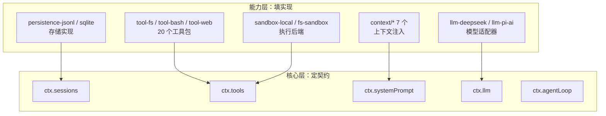
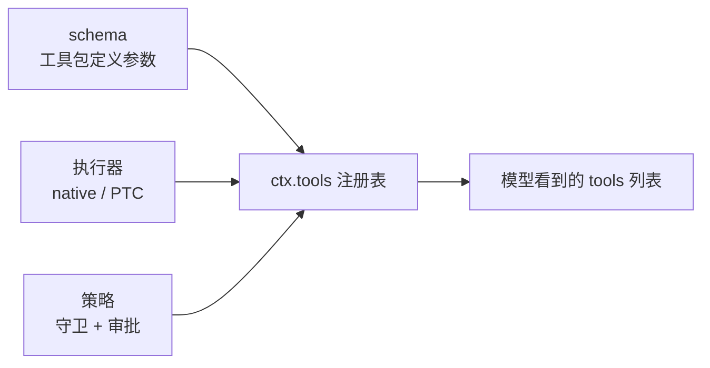

# 能力层手册 · 开篇：那 90 个插件包在做什么

> 第 18B 章说"90 个是叶子"。这篇导言把叶子摊开，后面 T1–T10 逐组细看。
>
> 两层的关系一句话：核心层决定**怎么协调**，能力层决定**能做什么**。前者的产物是契约，后者的产物是功能。

---

## 1. 两层怎么分

仓库里有 55 个域、几百个包。按职责切开，只有两类：

| | 核心层 | 能力层 |
|---|---|---|
| 数量 | 6 个包 | 其余全部 |
| 产物 | ctx 键、事件类型、seam 契约 | 工具、执行器、存储实现、连接器 |
| 被依赖方式 | 别人依赖它的契约 | 它依赖别人的契约 |
| 换掉它 | 换循环、换日志实现 | 换一个工具、换一个后端 |
| 名字 | `core/*`、`session-projection` | `tool-*`、`*-local`、`*-policy`、`connector/*` |

判据只有一条：**这个包有没有引入新的协调方式**。引入新 ctx 键、新事件类型、新 seam 的，是核心；只消费已有契约的，是能力。

按这条判据，`tool-bash` 是能力（它注册一个工具），`bash-sandbox` 也是能力（它提供一种执行后端），但 `sandbox` 这个 seam 定义是核心——它规定了"一个沙箱要实现哪几个方法"。



箭头方向是关键：能力包**指向**核心键，核心键不知道它们存在。所以加一个工具，核心层一行不改。

## 2. 一张地图：55 个域归成八类

不看包名，先看域。同一域里的包共享一个生命周期和一套约定。

| 类 | 代表域 | 代表包 | 干什么 |
|---|---|---|---|
| 工具 | `fs` `shell` `web` | `tool-fs` `tool-bash` | 给模型一双手 |
| 执行 | `sandbox` `ptc-runtime` | `sandbox-local` `ptc-runtime` | 命令在哪、以什么权限跑 |
| 上下文 | `context` `spill` | `time-context` `compaction-basic` | 往提示词加料、往外搬料 |
| 存储 | `storage` `session` | `storage-sqlite` `session-persistence-jsonl` | 事件与业务数据落盘 |
| 检索 | `lsp` `mcp` | `tool-fs-search` `tool-lsp` | 找东西，不用向量 |
| 接入 | `connector` `subagent` | `mcp-client` `subagent-fork-in-process` | 连外部系统与外部模型 |
| 交互 | `interaction` `plan` | `user-approval` `plan-mode` | 人怎么介入 |
| 观测 | `telemetry` `feedback` | `otel` `session-telemetry` | 看见发生了什么 |

八类里，**工具、执行、上下文**是 Agent 特有的；存储、检索、接入、交互、观测，传统后端也有，只是这里的形态被事件日志改造过。

## 3. 工具类：一个工具是三个东西拼起来的

模型看到的"工具"其实是三件独立的东西：

| 组成 | 谁提供 | 例子 |
|---|---|---|
| schema | 工具包 | `read_file` 的参数定义 |
| 执行 | 执行器 | native（宿主进程）或 PTC（代码里调） |
| 策略 | 守卫与审批 | 路径白名单、是否需要人批 |



拆开的好处很直接：同一个 `bash` 工具，可以在本机跑、在沙箱跑、在远程 SSH 跑，schema 与策略不变。所以 `shell` 域有 10 个包：`bash-local`、`bash-sandbox`、`pwsh-local`、`pwsh-sandbox`、`shell-env`、`tool-bash`、`tool-bash-persistent`……前缀就说明了谁是实现、谁是入口。

`persistent` 那个后缀值得注意：它表示 shell 会话跨调用保持（变量、当前目录不丢）。有状态的工具与无状态的工具，回收策略完全不同——前者要在会话结束时显式销毁，否则会漏进程。

全仓有 23 个 `tool-*` 包，其中"面向人类功能"的只有 3 个（todo、present、ask_user），其余 20 个都是文件、命令、网络、代码符号。

## 4. 执行类：native 与 PTC 是两种调用方式

同样一个工具，可以由模型逐次调用，也可以由模型写一段代码批量调用：

| | native | PTC（programmatic tool calling） |
|---|---|---|
| 谁发起 | 模型每次一个 tool_call | 模型写一段程序，程序里调工具 |
| 往返次数 | 每个调用一次往返 | 一次往返跑完整段程序 |
| 适合 | 步数少、要看中间结果 | 批量、规则明确、结果只在最后要 |
| 代价 | 往返多，token 多 | 出错难定位，权限面更大 |

`ptc-runtime` 域就是干这个的。它把工具暴露成函数，模型写的代码在受控运行时里执行，调用走同一套 `ctx.tools` 流水线——所以守卫和审批照样生效。

这条设计的意义：**工具调用的次数是成本，不是能力**。50 个文件要读，逐次调用是 50 次往返；写个循环是一次。差的是 49 次 prefill。

## 5. 沙箱：策略、实现、平台三件事

`sandbox` 域看起来包多，其实只有三层：

- **策略**：`sandbox-policy` 决定"这个操作要不要拦"
- **实现**：`sandbox-local`（本机隔离）、`sandbox-ssh`（远端机器）
- **平台特化**：`sandbox-windows-acl`（Windows 上只能用 ACL 表达权限）

`fs` 域同理：`fs`（接口）、`fs-local`（实现）、`fs-sandbox`（包一层沙箱）、`fs-observation-policy`（读写观察策略）、`fs-patch`（补丁式写入）。

分层的收益是：换平台只加一个实现包，策略和执行器的代码不动。代价是包多了——`fs` 域 8 个包，只有 2 个是模型能直接看到的工具。

## 6. 上下文类：七个包都在做同一件事

`context` 域 7 个包，功能各异，机制相同：**往 system 段或 user 段里加一段文本**。

| 包 | 加什么 | 加在哪 |
|---|---|---|
| `time-context` | 当前时间与时区 | user 快照 |
| `agent-instructions` | 目录里的 AGENTS.md | system 段 |
| `harness-dev-context` | 开发模式下的框架说明 | system 段 |
| `session-reference` | 被引用的其他会话片段 | user 段 |
| `file-reference` | 被 @ 的文件内容 | user 段 |
| `tmux-context` | 当前 tmux 面板状态 | user 快照 |

为什么时间也要单独一个包？因为它必须**每步重算**：一个跑了十分钟的任务，第二步的时间戳不能还是第一步的。放 system 段会被缓存住，放 user 快照才能每步刷新。

这也是能力层最容易被低估的一类：它们不提供新能力，只改变模型看到的世界。加错一个上下文包，模型的行为会莫名其妙地变，而工具调用一切正常。

## 7. 存储与检索：为什么没有向量库

`storage` 域三个包（接口、JSON、SQLite），`session` 域 23 个包里，6 个跟格式有关：4 个迁移包（v0→v1→v2→v3→v4）+ 1 个格式定义 + 1 个事件目录。

迁移包单独成包，是个值得学的做法：每次格式升级是一个可测试、可回滚的小单元，而不是散在读取逻辑里的 `if version < 3`。

检索这块，DSH 没有向量索引。`tool-fs-search` 背后是 ripgrep（`util/ripgrep` 封了二进制），`tool-lsp` 走语言服务器拿符号，`mcp-resources` 拿外部资源。

不用向量的理由很实在：**代码检索里，精确匹配的召回率比语义相似度高**。找一个函数名、一个错误码、一个配置键，grep 一次就中；向量检索要给每个文件算 embedding，还要处理增量更新，成本高一个数量级，召回还不稳。

代价是：问"哪里处理了退款"这种语义问题，grep 帮不上。DSH 的答案是让模型自己多试几次关键词，而不是预先建索引。

## 8. 接入类：MCP、连接器、子 agent

三类外部世界，三种接法：

| 类型 | 包 | 接什么 |
|---|---|---|
| MCP | `mcp-client` `mcp-manager` `mcp-resources` | 外部工具服务器 |
| 连接器 | `connector/feishu` `dingtalk` `notion` `linear` `wecom` | SaaS 账号与数据 |
| 子 agent | `subagent-fork-in-process` `spawn-in-process` `acp` `claude-code` `codex` | 别的 Agent 运行时 |

子 agent 有 9 个包，因为"派一个子 agent"有五种实现：同进程 fork、同进程新起、走 ACP 协议、调 Claude Code、调 Codex。上层看到的是同一个 `tool-subagent`，下层换实现不改调用方——又一个 seam。

## 9. 观测类：三个层次

`otel`（标准导出）、`session-telemetry`（会话级指标）、`session-stats`（聚合统计）、`session-title-*`（自动起标题，有 LLM 与首条提示词两种实现）。

三层解决三个问题：单次请求发生了什么（trace）、一类请求整体怎么样（metric）、这个会话讲了什么（title）。

`session-title-llm` 与 `session-title-first-prompt-llm` 并存，是成本与延迟的取舍：每次生成标题要一次额外调用，用首条提示词生成则免费但可能不准。

## 10. 命名就是文档

包名遵守几条硬约定，读名字就能定位职责：

| 前缀/后缀 | 含义 | 例 |
|---|---|---|
| `tool-` | 注册一个模型可见工具 | `tool-fs` `tool-web` |
| `-local` | 本机实现 | `fs-local` `sandbox-local` |
| `-sandbox` | 包了沙箱的实现 | `bash-sandbox` `fs-sandbox` |
| `-policy` | 策略，不执行 | `sandbox-policy` `spill-policy` |
| `-protocol` / `-format` | 契约，不含实现 | `typert-protocol` `session-format` |
| `command-` | 斜杠命令 | `command-compact` `command-goal` |
| `ui-` | 前端组件（79 个） | `ui-chat` `ui-tool` |

`client` 域 79 个包全是 `ui-*`，它们跑在浏览器里，通过 RPC 与宿主通信。这部分对理解 Agent 机制没有帮助，可以整块跳过。

## 11. 怎么读这 90 个包

三层读法，从抽象到具体：

1. **先看 ctx 键**（8 个）：哪八个能力面，比哪 90 个包重要。
2. **再看 `tool-*`**（约 20 个）：这是模型能做的事，也是产品功能的边界。
3. **最后按需看 `-local` / `-sandbox` / `connector`**：只在你要换实现或排查环境问题时才需要。

反过来读（从包名一个一个看过去）会淹死在一堆 `ui-*` 和格式迁移包里。

## 12. 失败模式

| 现象 | 根因 | 怎么发现 | 怎么修 |
|---|---|---|---|
| 加了个工具但模型不用 | schema 描述太含糊 | 看请求头里的 tools 定义 | 描述里写清何时用、举例 |
| 换了沙箱但权限没变 | 策略包没换 | 对比 policy 配置 | 策略与实现分开换 |
| 上下文包加多了，TTFT 涨 | 每步重算的段落太长 | 看 prompt token 数 | 挪到按需注入 |
| 子 agent 起不来 | 运行时包与协议不匹配 | 看 spawn 日志 | 换对应的 subagent-* |
| 迁移后老会话读不出 | 跳版本迁移 | 看 format 版本链 | 逐版本迁移，不跨级 |

## 13. 什么情况下这套分层不成立

- **工具少于 10 个**：分层的开销大于收益，直接写在一个包里更省事。
- **只有一个执行环境**：`-local` / `-sandbox` / `-ssh` 三套实现没意义。
- **需要工具间共享状态**（比如两个工具操作同一个缓冲区）：ctx 键的粒度不够，得引入显式的会话级服务。

第三条是 Agent 平台做复杂之后的真实痛点：工具越多，越需要一个"工作区"对象承载共享状态，而它既不属于工具，也不属于核心。

## 14. 验收

1. 能说出核心层与能力层的判据。
2. 能给一个工具包指出它的 schema、执行器、策略分别在哪。
3. 能解释为什么 DSH 不用向量索引，以及这个选择的代价。
4. 能从包名判断它是接口、实现还是策略。

## 15. 复盘卡

```
我原来以为…实际…差在：
```

我原来以为"插件多"意味着系统复杂。实际差在分层：90 个包之所以不互相拖累，是因为它们全都只往 8 个键上挂，谁也不知道谁。

## 16. 延伸

- 第 18A 章：包怎么管、怎么装、用什么语言
- 第 18B 章：六层依赖与八个 ctx 键
- 第 19 章：会话日志怎么承载这一切

小结：核心层六个包定义协调方式，能力层九十多个包填充具体能力。读这份清单的顺序是先键、再工具、最后实现——反过来会被 `ui-*` 淹掉。
